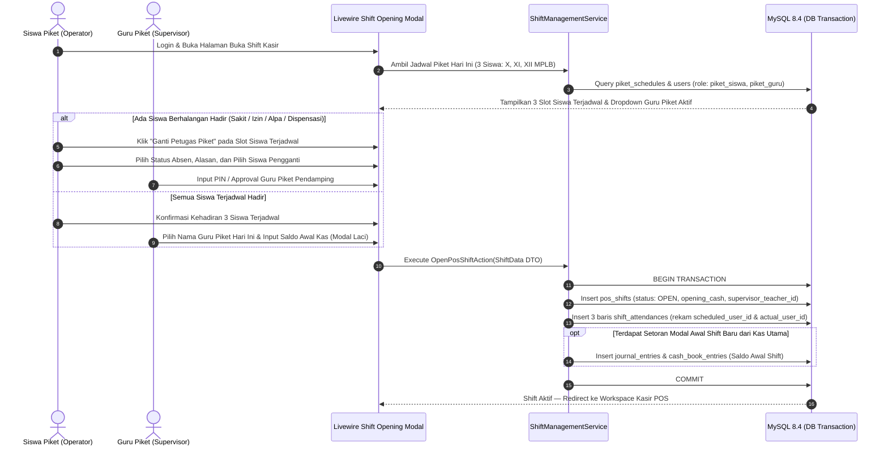
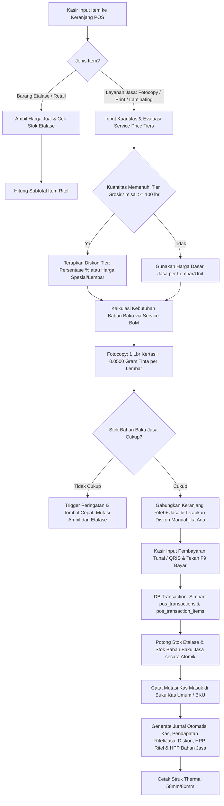
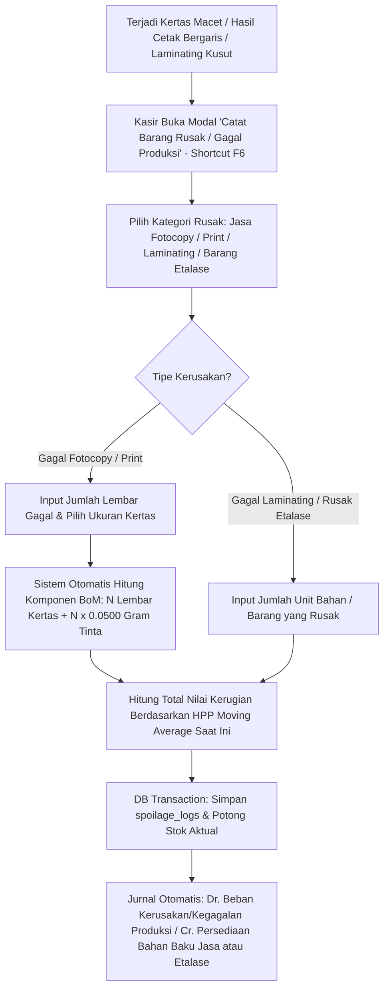
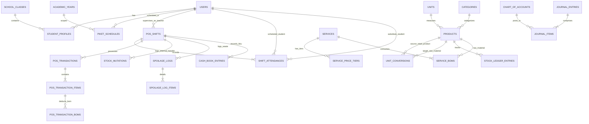

# BAGIAN 1: DOKUMEN PRD & ARSITEKTUR TEKNIS "BESTCO"

**BESTCO (Business Center & Teaching Factory MPLB)** adalah platform Enterprise Resource Planning (ERP) skala ritel-jasa, Point of Sale (POS), Manajemen Piket Praktik Siswa, Dual-Inventory Management, dan Sistem Akuntansi Siklus Lengkap (*Full-Cycle Double-Entry Accounting*) yang dirancang khusus untuk operasional laboratorium praktik **Manajemen Perkantoran dan Layanan Bisnis (MPLB)**.

---

## 1. Executive Summary & Business Flow Diagram

### 1.1 Ringkasan Eksekutif & Solusi Arsitektural
Operasional Teaching Factory (TeFa) MPLB memiliki karakteristik unik yang menggabungkan **perdagangan ritel (ATK Etalase)** dan **manufaktur ringan berbasis jasa (Fotocopy, Print, Laminating, Penjilidan)** yang dioperasikan secara bergilir oleh siswa dan disupervisi oleh guru piket.

Empat pilar arsitektur utama yang diterapkan pada BESTCO:
1. **Resolusi Presisi Desimal Tinta (`DECIMAL(19,4)` vs Rasio Tinta):** Konsumsi tinta fotocopy adalah $1\text{ Kg}$ untuk $20.000\text{ lembar}$ ($0,00005\text{ Kg/lembar}$). Karena tipe data `DECIMAL(19,4)` memiliki presisi maksimal 4 angka di belakang koma (`0.0001`), penyimpanan stok dasar (*Base Unit of Measure*) bahan baku tinta wajib menggunakan satuan **Gram (`g`)**. Dengan basis Gram, $1\text{ Kg}$ tinta tercatat sebagai `1000.0000 g` dan setiap lembar fotocopy memotong tepat `0.0500 g` tinta—menghasilkan akurasi matematis $100\%$ tanpa risiko *rounding truncation*.
2. **Dual-Inventory dengan Konversi Satuan Otomatis (UoM Mutation):** Memisahkan secara ketat **Persediaan Barang Dagang (Etalase)** dan **Persediaan Bahan Baku Jasa**. Ketika kertas layanan jasa habis saat jam sibuk, operator dapat memutasi `1 Rim` Kertas HVS dari Etalase yang secara otomatis dikonversi menjadi `+500.0000 Lembar` di stok Bahan Baku Jasa sekaligus menjurnal pemindahan nilai HPP antar akun persediaan.
3. **Pencatatan Barang Rusak (*Spoilage*) Berbasis Bill of Materials (BoM):** Kegagalan produksi (kertas macet/nyangkut, hasil cetak bergaris, plastik laminating kusut) tetap memotong stok bahan baku kertas dan kuota tinta (`0.0500 g/lembar`) serta membebankannya secara *real-time* ke akun **Beban Kerusakan / Kegagalan Produksi Jasa**.
4. **Akuntansi *Double-Entry Immutable*:** Setiap transaksi kasir, mutasi internal, barang rusak, hingga penutupan shift kasir berjalan di dalam satu *database transaction* (`DB::transaction`) yang atomik. Jurnal yang telah diposting bersifat *immutable* (tidak dapat dihapus/diedit; koreksi wajib melalui Jurnal Pembalik atau Jurnal Penyesuaian).

### 1.2 Business Flow Diagrams (Mermaid.js)

#### A. Alur Pembukaan Shift Piket Siswa (3 Siswa + Substitusi) & Guru Piket Fleksibel


#### B. Alur Transaksi POS Gabungan (Barang Etalase + Jasa Diskon Bertingkat)


#### C. Alur Mutasi Stok Internal (Ambil Barang Etalase ke Bahan Baku Jasa)

```mermaid
flowchart LR
    A[Stok Kertas Bahan Jasa Menipis/Habis] --> B[Klik 'Ambil dari Etalase' di POS/Inventori]
    B --> C[Pilih Aturan Konversi: 1 Rim Kertas A4 Etalase -> 500 Lembar Bahan Jasa]
    C --> D[Input Kuantitas Rim & Approval Guru Piket / Admin]
    D --> E[Execute InternalStockMutationAction dalam DB Transaction]
    E --> F[Kurangi Stok Etalase: -1.0000 Rim @ HPP Rp 45.000]
    F --> G[Tambah Stok Bahan Jasa: +500.0000 Lembar @ HPP Rp 90/lembar]
    G --> H[Rekalc Moving Average Cost Bahan Jasa]
    H --> I[Jurnal Otomatis: Dr. Persediaan Bahan Baku Jasa Rp 45.000 / Cr. Persediaan Barang Dagang Rp 45.000]
```


#### D. Alur Pencatatan Barang Rusak / Gagal Fotocopy & Print (*Spoilage Management*)


---

## 2. Database Schema Lengkap (ERD & Struktur Tabel Detail)

Seluruh tabel menggunakan engine `InnoDB`, charset `utf8mb4_unicode_ci`, dan tipe data `DECIMAL(19,4)` untuk nilai uang maupun kuantitas stok agar mendukung pemotongan fraksional (`0.0500` gram tinta).

### 2.1 Entity Relationship Diagram (Mermaid.js)


### 2.2 Spesifikasi DDL SQL Lengkap (`database/schema/bestco_schema.sql`)

```sql
-- ============================================================================
-- 1. SYSTEM SETTINGS, USERS, ACADEMIC & PIKET MANAGEMENT
-- ============================================================================

CREATE TABLE system_settings (
    id BIGINT UNSIGNED AUTO_INCREMENT PRIMARY KEY,
    setting_group VARCHAR(50) NOT NULL COMMENT 'theme, accounting, pos, school',
    setting_key VARCHAR(100) NOT NULL UNIQUE,
    setting_value JSON NOT NULL,
    updated_by BIGINT UNSIGNED NULL,
    created_at TIMESTAMP NULL DEFAULT CURRENT_TIMESTAMP,
    updated_at TIMESTAMP NULL DEFAULT CURRENT_TIMESTAMP ON UPDATE CURRENT_TIMESTAMP,
    INDEX idx_settings_group (setting_group)
) ENGINE=InnoDB DEFAULT CHARSET=utf8mb4 COLLATE=utf8mb4_unicode_ci;

CREATE TABLE users (
    id BIGINT UNSIGNED AUTO_INCREMENT PRIMARY KEY,
    name VARCHAR(150) NOT NULL,
    username VARCHAR(50) NOT NULL UNIQUE,
    email VARCHAR(150) NULL UNIQUE,
    nip_nisn VARCHAR(30) NULL UNIQUE COMMENT 'NIP untuk Guru/Admin, NISN untuk Siswa',
    password VARCHAR(255) NOT NULL,
    pin_code VARCHAR(255) NULL COMMENT 'Hashed 6-digit PIN untuk approval cepat Guru Piket',
    role_type ENUM('superadmin', 'admin', 'piket_guru', 'piket_siswa') NOT NULL,
    is_active BOOLEAN NOT NULL DEFAULT TRUE,
    last_login_at TIMESTAMP NULL,
    remember_token VARCHAR(100) NULL,
    created_at TIMESTAMP NULL DEFAULT CURRENT_TIMESTAMP,
    updated_at TIMESTAMP NULL DEFAULT CURRENT_TIMESTAMP ON UPDATE CURRENT_TIMESTAMP,
    INDEX idx_users_role_active (role_type, is_active)
) ENGINE=InnoDB DEFAULT CHARSET=utf8mb4 COLLATE=utf8mb4_unicode_ci;

CREATE TABLE academic_years (
    id BIGINT UNSIGNED AUTO_INCREMENT PRIMARY KEY,
    name VARCHAR(20) NOT NULL UNIQUE COMMENT 'Contoh: 2026/2027',
    semester ENUM('GANJIL', 'GENAP') NOT NULL,
    start_date DATE NOT NULL,
    end_date DATE NOT NULL,
    is_active BOOLEAN NOT NULL DEFAULT FALSE,
    created_at TIMESTAMP NULL DEFAULT CURRENT_TIMESTAMP,
    updated_at TIMESTAMP NULL DEFAULT CURRENT_TIMESTAMP ON UPDATE CURRENT_TIMESTAMP
) ENGINE=InnoDB DEFAULT CHARSET=utf8mb4 COLLATE=utf8mb4_unicode_ci;

CREATE TABLE school_classes (
    id BIGINT UNSIGNED AUTO_INCREMENT PRIMARY KEY,
    academic_year_id BIGINT UNSIGNED NOT NULL,
    grade_level ENUM('X', 'XI', 'XII') NOT NULL COMMENT 'Tingkat kelas MPLB',
    name VARCHAR(50) NOT NULL COMMENT 'Contoh: X MPLB 1, XI MPLB 2, XII MPLB 1',
    homeroom_teacher_id BIGINT UNSIGNED NULL,
    created_at TIMESTAMP NULL DEFAULT CURRENT_TIMESTAMP,
    updated_at TIMESTAMP NULL DEFAULT CURRENT_TIMESTAMP ON UPDATE CURRENT_TIMESTAMP,
    CONSTRAINT fk_classes_academic_year FOREIGN KEY (academic_year_id) REFERENCES academic_years(id),
    CONSTRAINT fk_classes_teacher FOREIGN KEY (homeroom_teacher_id) REFERENCES users(id) ON DELETE SET NULL,
    INDEX idx_classes_grade (grade_level)
) ENGINE=InnoDB DEFAULT CHARSET=utf8mb4 COLLATE=utf8mb4_unicode_ci;

CREATE TABLE student_profiles (
    id BIGINT UNSIGNED AUTO_INCREMENT PRIMARY KEY,
    user_id BIGINT UNSIGNED NOT NULL UNIQUE,
    school_class_id BIGINT UNSIGNED NOT NULL,
    nis VARCHAR(25) NOT NULL UNIQUE,
    phone VARCHAR(20) NULL,
    total_piket_completed INT UNSIGNED NOT NULL DEFAULT 0,
    total_substitute_completed INT UNSIGNED NOT NULL DEFAULT 0,
    created_at TIMESTAMP NULL DEFAULT CURRENT_TIMESTAMP,
    updated_at TIMESTAMP NULL DEFAULT CURRENT_TIMESTAMP ON UPDATE CURRENT_TIMESTAMP,
    CONSTRAINT fk_student_user FOREIGN KEY (user_id) REFERENCES users(id) ON DELETE CASCADE,
    CONSTRAINT fk_student_class FOREIGN KEY (school_class_id) REFERENCES school_classes(id)
) ENGINE=InnoDB DEFAULT CHARSET=utf8mb4 COLLATE=utf8mb4_unicode_ci;

CREATE TABLE piket_schedules (
    id BIGINT UNSIGNED AUTO_INCREMENT PRIMARY KEY,
    academic_year_id BIGINT UNSIGNED NOT NULL,
    schedule_date DATE NOT NULL,
    day_of_week TINYINT UNSIGNED NOT NULL COMMENT '1=Senin s.d. 7=Minggu',
    slot_number TINYINT UNSIGNED NOT NULL COMMENT '1 (Perwakilan X), 2 (Perwakilan XI), 3 (Perwakilan XII)',
    school_class_id BIGINT UNSIGNED NOT NULL,
    scheduled_student_id BIGINT UNSIGNED NOT NULL,
    notes VARCHAR(255) NULL,
    created_at TIMESTAMP NULL DEFAULT CURRENT_TIMESTAMP,
    updated_at TIMESTAMP NULL DEFAULT CURRENT_TIMESTAMP ON UPDATE CURRENT_TIMESTAMP,
    CONSTRAINT fk_piket_academic FOREIGN KEY (academic_year_id) REFERENCES academic_years(id),
    CONSTRAINT fk_piket_class FOREIGN KEY (school_class_id) REFERENCES school_classes(id),
    CONSTRAINT fk_piket_student FOREIGN KEY (scheduled_student_id) REFERENCES users(id),
    UNIQUE KEY uq_schedule_date_slot (schedule_date, slot_number),
    INDEX idx_piket_date (schedule_date)
) ENGINE=InnoDB DEFAULT CHARSET=utf8mb4 COLLATE=utf8mb4_unicode_ci;

CREATE TABLE pos_shifts (
    id BIGINT UNSIGNED AUTO_INCREMENT PRIMARY KEY,
    shift_code VARCHAR(30) NOT NULL UNIQUE COMMENT 'Contoh: SHF-20261030-01',
    shift_date DATE NOT NULL,
    supervisor_teacher_id BIGINT UNSIGNED NOT NULL COMMENT 'Guru piket fleksibel yang bertugas hari itu',
    opened_by_user_id BIGINT UNSIGNED NOT NULL,
    closed_by_user_id BIGINT UNSIGNED NULL,
    opened_at TIMESTAMP NOT NULL DEFAULT CURRENT_TIMESTAMP,
    closed_at TIMESTAMP NULL,
    opening_cash_balance DECIMAL(19,4) NOT NULL DEFAULT 0.0000,
    system_expected_cash DECIMAL(19,4) NOT NULL DEFAULT 0.0000,
    actual_closing_cash DECIMAL(19,4) NULL,
    cash_discrepancy DECIMAL(19,4) NULL COMMENT 'Selisih kas: actual - expected',
    status ENUM('OPEN', 'CLOSED', 'AUDITED') NOT NULL DEFAULT 'OPEN',
    closing_notes TEXT NULL,
    created_at TIMESTAMP NULL DEFAULT CURRENT_TIMESTAMP,
    updated_at TIMESTAMP NULL DEFAULT CURRENT_TIMESTAMP ON UPDATE CURRENT_TIMESTAMP,
    CONSTRAINT fk_shift_teacher FOREIGN KEY (supervisor_teacher_id) REFERENCES users(id),
    CONSTRAINT fk_shift_opener FOREIGN KEY (opened_by_user_id) REFERENCES users(id),
    CONSTRAINT fk_shift_closer FOREIGN KEY (closed_by_user_id) REFERENCES users(id),
    INDEX idx_shifts_date_status (shift_date, status)
) ENGINE=InnoDB DEFAULT CHARSET=utf8mb4 COLLATE=utf8mb4_unicode_ci;

CREATE TABLE shift_attendances (
    id BIGINT UNSIGNED AUTO_INCREMENT PRIMARY KEY,
    pos_shift_id BIGINT UNSIGNED NOT NULL,
    piket_schedule_id BIGINT UNSIGNED NULL,
    slot_number TINYINT UNSIGNED NOT NULL COMMENT 'Slot 1, 2, atau 3',
    scheduled_user_id BIGINT UNSIGNED NOT NULL COMMENT 'Siswa yang dijadwalkan awal',
    scheduled_student_status ENUM('PRESENT', 'SICK', 'PERMITTED', 'ABSENT', 'DISPENSATION') NOT NULL DEFAULT 'PRESENT',
    absence_reason VARCHAR(255) NULL COMMENT 'Wajib diisi jika status != PRESENT',
    is_substituted BOOLEAN NOT NULL DEFAULT FALSE,
    substituted_user_id BIGINT UNSIGNED NULL COMMENT 'Siswa pengganti yang hadir aktual',
    active_operator_user_id BIGINT UNSIGNED NOT NULL COMMENT 'scheduled_user_id jika hadir, atau substituted_user_id jika diganti',
    check_in_at TIMESTAMP NOT NULL DEFAULT CURRENT_TIMESTAMP,
    check_out_at TIMESTAMP NULL,
    approved_by_teacher_id BIGINT UNSIGNED NOT NULL,
    created_at TIMESTAMP NULL DEFAULT CURRENT_TIMESTAMP,
    updated_at TIMESTAMP NULL DEFAULT CURRENT_TIMESTAMP ON UPDATE CURRENT_TIMESTAMP,
    CONSTRAINT fk_att_shift FOREIGN KEY (pos_shift_id) REFERENCES pos_shifts(id) ON DELETE CASCADE,
    CONSTRAINT fk_att_schedule FOREIGN KEY (piket_schedule_id) REFERENCES piket_schedules(id) ON DELETE SET NULL,
    CONSTRAINT fk_att_scheduled_user FOREIGN KEY (scheduled_user_id) REFERENCES users(id),
    CONSTRAINT fk_att_sub_user FOREIGN KEY (substituted_user_id) REFERENCES users(id),
    CONSTRAINT fk_att_active_user FOREIGN KEY (active_operator_user_id) REFERENCES users(id),
    CONSTRAINT fk_att_teacher FOREIGN KEY (approved_by_teacher_id) REFERENCES users(id),
    UNIQUE KEY uq_shift_slot (pos_shift_id, slot_number)
) ENGINE=InnoDB DEFAULT CHARSET=utf8mb4 COLLATE=utf8mb4_unicode_ci;

-- ============================================================================
-- 2. DUAL INVENTORY (RETAIL VS RAW MATERIAL) & UNIT CONVERSIONS
-- ============================================================================

CREATE TABLE units (
    id BIGINT UNSIGNED AUTO_INCREMENT PRIMARY KEY,
    code VARCHAR(15) NOT NULL UNIQUE COMMENT 'RIM, LBR, PCS, PACK, BOX, KG, GRM',
    name VARCHAR(50) NOT NULL COMMENT 'Rim, Lembar, Pcs, Pack, Box, Kilogram, Gram',
    allow_decimal BOOLEAN NOT NULL DEFAULT FALSE COMMENT 'TRUE untuk Gram/Kg, FALSE untuk Pcs/Lembar',
    created_at TIMESTAMP NULL DEFAULT CURRENT_TIMESTAMP,
    updated_at TIMESTAMP NULL DEFAULT CURRENT_TIMESTAMP ON UPDATE CURRENT_TIMESTAMP
) ENGINE=InnoDB DEFAULT CHARSET=utf8mb4 COLLATE=utf8mb4_unicode_ci;

CREATE TABLE categories (
    id BIGINT UNSIGNED AUTO_INCREMENT PRIMARY KEY,
    name VARCHAR(100) NOT NULL,
    slug VARCHAR(120) NOT NULL UNIQUE,
    category_scope ENUM('RETAIL', 'RAW_MATERIAL', 'SERVICE') NOT NULL,
    created_at TIMESTAMP NULL DEFAULT CURRENT_TIMESTAMP,
    updated_at TIMESTAMP NULL DEFAULT CURRENT_TIMESTAMP ON UPDATE CURRENT_TIMESTAMP
) ENGINE=InnoDB DEFAULT CHARSET=utf8mb4 COLLATE=utf8mb4_unicode_ci;

CREATE TABLE products (
    id BIGINT UNSIGNED AUTO_INCREMENT PRIMARY KEY,
    sku VARCHAR(50) NOT NULL UNIQUE,
    barcode VARCHAR(64) NULL UNIQUE,
    name VARCHAR(180) NOT NULL,
    category_id BIGINT UNSIGNED NOT NULL,
    unit_id BIGINT UNSIGNED NOT NULL,
    inventory_type ENUM('RETAIL', 'RAW_MATERIAL') NOT NULL COMMENT 'RETAIL=Stok Etalase, RAW_MATERIAL=Bahan Baku Jasa',
    current_stock DECIMAL(19,4) NOT NULL DEFAULT 0.0000,
    min_stock_alert DECIMAL(19,4) NOT NULL DEFAULT 5.0000,
    average_cost DECIMAL(19,4) NOT NULL DEFAULT 0.0000 COMMENT 'HPP Moving Average per Base Unit',
    last_purchase_price DECIMAL(19,4) NOT NULL DEFAULT 0.0000,
    selling_price DECIMAL(19,4) NOT NULL DEFAULT 0.0000 COMMENT 'Harga jual ritel (0 untuk RAW_MATERIAL murni)',
    inventory_account_id BIGINT UNSIGNED NOT NULL COMMENT 'FK ke COA Persediaan Etalase atau Bahan Jasa',
    cogs_account_id BIGINT UNSIGNED NOT NULL COMMENT 'FK ke COA HPP Ritel atau HPP Jasa',
    is_active BOOLEAN NOT NULL DEFAULT TRUE,
    created_at TIMESTAMP NULL DEFAULT CURRENT_TIMESTAMP,
    updated_at TIMESTAMP NULL DEFAULT CURRENT_TIMESTAMP ON UPDATE CURRENT_TIMESTAMP,
    CONSTRAINT fk_prod_category FOREIGN KEY (category_id) REFERENCES categories(id),
    CONSTRAINT fk_prod_unit FOREIGN KEY (unit_id) REFERENCES units(id),
    INDEX idx_products_type_active (inventory_type, is_active),
    INDEX idx_products_name (name)
) ENGINE=InnoDB DEFAULT CHARSET=utf8mb4 COLLATE=utf8mb4_unicode_ci;

CREATE TABLE unit_conversions (
    id BIGINT UNSIGNED AUTO_INCREMENT PRIMARY KEY,
    source_product_id BIGINT UNSIGNED NOT NULL COMMENT 'Produk Etalase (misal: Kertas HVS A4 75gr [Rim])',
    target_product_id BIGINT UNSIGNED NOT NULL COMMENT 'Produk Bahan Jasa (misal: Kertas HVS A4 75gr [Lembar])',
    source_unit_id BIGINT UNSIGNED NOT NULL,
    target_unit_id BIGINT UNSIGNED NOT NULL,
    conversion_factor DECIMAL(19,4) NOT NULL COMMENT 'Contoh: 500.0000 (1 Rim = 500 Lembar) atau 1000.0000 (1 Kg = 1000 Gram)',
    is_active BOOLEAN NOT NULL DEFAULT TRUE,
    created_at TIMESTAMP NULL DEFAULT CURRENT_TIMESTAMP,
    updated_at TIMESTAMP NULL DEFAULT CURRENT_TIMESTAMP ON UPDATE CURRENT_TIMESTAMP,
    CONSTRAINT fk_conv_source_prod FOREIGN KEY (source_product_id) REFERENCES products(id),
    CONSTRAINT fk_conv_target_prod FOREIGN KEY (target_product_id) REFERENCES products(id),
    CONSTRAINT fk_conv_source_unit FOREIGN KEY (source_unit_id) REFERENCES units(id),
    CONSTRAINT fk_conv_target_unit FOREIGN KEY (target_unit_id) REFERENCES units(id),
    UNIQUE KEY uq_source_target_product (source_product_id, target_product_id)
) ENGINE=InnoDB DEFAULT CHARSET=utf8mb4 COLLATE=utf8mb4_unicode_ci;

-- ============================================================================
-- 3. SERVICES, TIERED PRICING (>100 SHEETS), & BILL OF MATERIALS (BoM)
-- ============================================================================

CREATE TABLE services (
    id BIGINT UNSIGNED AUTO_INCREMENT PRIMARY KEY,
    code VARCHAR(40) NOT NULL UNIQUE COMMENT 'SRV-FC-A4, SRV-PRT-BW, SRV-PRT-CL-LIGHT, SRV-PRT-CL-FULL, SRV-LAM-SM, SRV-LAM-LG',
    name VARCHAR(150) NOT NULL,
    category_id BIGINT UNSIGNED NOT NULL,
    service_group ENUM('FOTOCOPY', 'PRINT', 'LAMINATING', 'BINDING', 'SCAN', 'OTHER') NOT NULL,
    base_unit_name VARCHAR(30) NOT NULL DEFAULT 'Lembar' COMMENT 'Lembar, Dokumen, Buku, Pcs',
    base_price DECIMAL(19,4) NOT NULL COMMENT 'Harga normal per satuan sebelum diskon grosir',
    revenue_account_id BIGINT UNSIGNED NOT NULL COMMENT 'FK ke COA Pendapatan Jasa',
    discount_account_id BIGINT UNSIGNED NOT NULL COMMENT 'FK ke COA Potongan Pendapatan Jasa',
    is_active BOOLEAN NOT NULL DEFAULT TRUE,
    created_at TIMESTAMP NULL DEFAULT CURRENT_TIMESTAMP,
    updated_at TIMESTAMP NULL DEFAULT CURRENT_TIMESTAMP ON UPDATE CURRENT_TIMESTAMP,
    CONSTRAINT fk_srv_category FOREIGN KEY (category_id) REFERENCES categories(id),
    INDEX idx_services_group (service_group, is_active)
) ENGINE=InnoDB DEFAULT CHARSET=utf8mb4 COLLATE=utf8mb4_unicode_ci;

CREATE TABLE service_price_tiers (
    id BIGINT UNSIGNED AUTO_INCREMENT PRIMARY KEY,
    service_id BIGINT UNSIGNED NOT NULL,
    tier_name VARCHAR(100) NOT NULL COMMENT 'Contoh: Grosir >= 100 Lembar',
    min_qty DECIMAL(19,4) NOT NULL COMMENT 'Contoh: 100.0000',
    max_qty DECIMAL(19,4) NULL COMMENT 'NULL berarti tak terbatas ke atas',
    discount_type ENUM('PERCENTAGE', 'FIXED_DISCOUNT_PER_UNIT', 'SPECIAL_UNIT_PRICE') NOT NULL,
    discount_value DECIMAL(19,4) NOT NULL COMMENT 'Jika PERCENTAGE: 10.0000 (10%), Jika FIXED: potongan Rp/unit, Jika SPECIAL: harga baru Rp/unit',
    priority INT UNSIGNED NOT NULL DEFAULT 1,
    is_active BOOLEAN NOT NULL DEFAULT TRUE,
    created_at TIMESTAMP NULL DEFAULT CURRENT_TIMESTAMP,
    updated_at TIMESTAMP NULL DEFAULT CURRENT_TIMESTAMP ON UPDATE CURRENT_TIMESTAMP,
    CONSTRAINT fk_tier_service FOREIGN KEY (service_id) REFERENCES services(id) ON DELETE CASCADE,
    INDEX idx_tier_lookup (service_id, is_active, min_qty)
) ENGINE=InnoDB DEFAULT CHARSET=utf8mb4 COLLATE=utf8mb4_unicode_ci;

CREATE TABLE service_boms (
    id BIGINT UNSIGNED AUTO_INCREMENT PRIMARY KEY,
    service_id BIGINT UNSIGNED NOT NULL,
    raw_material_product_id BIGINT UNSIGNED NOT NULL COMMENT 'FK ke products dengan inventory_type = RAW_MATERIAL',
    consumption_qty DECIMAL(19,4) NOT NULL COMMENT 'Kertas = 1.0000 Lembar, Tinta Fotocopy = 0.0500 Gram (setara 0.00005 Kg)',
    is_required BOOLEAN NOT NULL DEFAULT TRUE,
    notes VARCHAR(255) NULL,
    created_at TIMESTAMP NULL DEFAULT CURRENT_TIMESTAMP,
    updated_at TIMESTAMP NULL DEFAULT CURRENT_TIMESTAMP ON UPDATE CURRENT_TIMESTAMP,
    CONSTRAINT fk_bom_service FOREIGN KEY (service_id) REFERENCES services(id) ON DELETE CASCADE,
    CONSTRAINT fk_bom_raw_product FOREIGN KEY (raw_material_product_id) REFERENCES products(id),
    UNIQUE KEY uq_service_raw_material (service_id, raw_material_product_id)
) ENGINE=InnoDB DEFAULT CHARSET=utf8mb4 COLLATE=utf8mb4_unicode_ci;

-- ============================================================================
-- 4. INTERNAL STOCK MUTATIONS, LEDGER, & SPOILAGE (BARANG RUSAK)
-- ============================================================================

CREATE TABLE stock_mutations (
    id BIGINT UNSIGNED AUTO_INCREMENT PRIMARY KEY,
    mutation_number VARCHAR(40) NOT NULL UNIQUE COMMENT 'MUT-20261030-0001',
    pos_shift_id BIGINT UNSIGNED NULL,
    unit_conversion_id BIGINT UNSIGNED NOT NULL,
    source_product_id BIGINT UNSIGNED NOT NULL COMMENT 'Barang Etalase yang diambil (Rim)',
    target_product_id BIGINT UNSIGNED NOT NULL COMMENT 'Bahan Baku Jasa yang bertambah (Lembar)',
    source_qty_deducted DECIMAL(19,4) NOT NULL COMMENT 'Contoh: 1.0000 Rim',
    conversion_factor DECIMAL(19,4) NOT NULL COMMENT 'Contoh: 500.0000',
    target_qty_added DECIMAL(19,4) NOT NULL COMMENT 'Contoh: 500.0000 Lembar',
    source_unit_cost DECIMAL(19,4) NOT NULL COMMENT 'HPP per Rim saat mutasi, misal 45000.0000',
    target_unit_cost DECIMAL(19,4) NOT NULL COMMENT 'HPP per Lembar hasil konversi, misal 90.0000',
    total_mutation_value DECIMAL(19,4) NOT NULL COMMENT 'Total nilai buku yang dimutasi',
    requested_by_user_id BIGINT UNSIGNED NOT NULL,
    approved_by_user_id BIGINT UNSIGNED NOT NULL COMMENT 'Guru Piket atau Admin',
    journal_entry_id BIGINT UNSIGNED NULL,
    notes VARCHAR(255) NULL,
    mutated_at TIMESTAMP NOT NULL DEFAULT CURRENT_TIMESTAMP,
    created_at TIMESTAMP NULL DEFAULT CURRENT_TIMESTAMP,
    updated_at TIMESTAMP NULL DEFAULT CURRENT_TIMESTAMP ON UPDATE CURRENT_TIMESTAMP,
    CONSTRAINT fk_mut_shift FOREIGN KEY (pos_shift_id) REFERENCES pos_shifts(id),
    CONSTRAINT fk_mut_conv FOREIGN KEY (unit_conversion_id) REFERENCES unit_conversions(id),
    CONSTRAINT fk_mut_src_prod FOREIGN KEY (source_product_id) REFERENCES products(id),
    CONSTRAINT fk_mut_trg_prod FOREIGN KEY (target_product_id) REFERENCES products(id),
    CONSTRAINT fk_mut_req_user FOREIGN KEY (requested_by_user_id) REFERENCES users(id),
    CONSTRAINT fk_mut_app_user FOREIGN KEY (approved_by_user_id) REFERENCES users(id)
) ENGINE=InnoDB DEFAULT CHARSET=utf8mb4 COLLATE=utf8mb4_unicode_ci;

CREATE TABLE spoilage_logs (
    id BIGINT UNSIGNED AUTO_INCREMENT PRIMARY KEY,
    spoilage_number VARCHAR(40) NOT NULL UNIQUE COMMENT 'SPL-20261030-0001',
    pos_shift_id BIGINT UNSIGNED NULL,
    spoilage_source ENUM('SERVICE_PRODUCTION', 'RETAIL_DAMAGE', 'RAW_MATERIAL_DAMAGE') NOT NULL,
    service_id BIGINT UNSIGNED NULL COMMENT 'Diisi jika gagal fotocopy/print/laminating',
    failed_output_qty DECIMAL(19,4) NOT NULL DEFAULT 0.0000 COMMENT 'Jumlah lembar gagal fotocopy/print',
    reason_category ENUM('PAPER_JAM', 'STREAKED_PRINT', 'MISPRINT_OPERATOR', 'TONER_SMEAR', 'LAMINATING_WRINKLE', 'PHYSICAL_DAMAGE', 'OTHER') NOT NULL,
    reason_description VARCHAR(255) NOT NULL,
    total_spoilage_cost DECIMAL(19,4) NOT NULL DEFAULT 0.0000 COMMENT 'Akumulasi HPP kertas + tinta 0.05g/lembar yang terbuang',
    reported_by_user_id BIGINT UNSIGNED NOT NULL,
    verified_by_user_id BIGINT UNSIGNED NULL COMMENT 'Guru Piket / Admin',
    journal_entry_id BIGINT UNSIGNED NULL,
    logged_at TIMESTAMP NOT NULL DEFAULT CURRENT_TIMESTAMP,
    created_at TIMESTAMP NULL DEFAULT CURRENT_TIMESTAMP,
    updated_at TIMESTAMP NULL DEFAULT CURRENT_TIMESTAMP ON UPDATE CURRENT_TIMESTAMP,
    CONSTRAINT fk_spl_shift FOREIGN KEY (pos_shift_id) REFERENCES pos_shifts(id),
    CONSTRAINT fk_spl_service FOREIGN KEY (service_id) REFERENCES services(id),
    CONSTRAINT fk_spl_reporter FOREIGN KEY (reported_by_user_id) REFERENCES users(id),
    CONSTRAINT fk_spl_verifier FOREIGN KEY (verified_by_user_id) REFERENCES users(id)
) ENGINE=InnoDB DEFAULT CHARSET=utf8mb4 COLLATE=utf8mb4_unicode_ci;

CREATE TABLE spoilage_log_items (
    id BIGINT UNSIGNED AUTO_INCREMENT PRIMARY KEY,
    spoilage_log_id BIGINT UNSIGNED NOT NULL,
    product_id BIGINT UNSIGNED NOT NULL COMMENT 'Kertas (Lembar), Tinta (Gram), atau Barang Etalase',
    qty_wasted DECIMAL(19,4) NOT NULL COMMENT 'Contoh: 10.0000 Lembar Kertas atau 0.5000 Gram Tinta (10 x 0.05g)',
    unit_cost_at_spoilage DECIMAL(19,4) NOT NULL,
    subtotal_cost DECIMAL(19,4) NOT NULL,
    created_at TIMESTAMP NULL DEFAULT CURRENT_TIMESTAMP,
    updated_at TIMESTAMP NULL DEFAULT CURRENT_TIMESTAMP ON UPDATE CURRENT_TIMESTAMP,
    CONSTRAINT fk_spli_log FOREIGN KEY (spoilage_log_id) REFERENCES spoilage_logs(id) ON DELETE CASCADE,
    CONSTRAINT fk_spli_prod FOREIGN KEY (product_id) REFERENCES products(id)
) ENGINE=InnoDB DEFAULT CHARSET=utf8mb4 COLLATE=utf8mb4_unicode_ci;

CREATE TABLE stock_ledger_entries (
    id BIGINT UNSIGNED AUTO_INCREMENT PRIMARY KEY,
    product_id BIGINT UNSIGNED NOT NULL,
    pos_shift_id BIGINT UNSIGNED NULL,
    reference_type VARCHAR(60) NOT NULL COMMENT 'POS_SALE, SERVICE_BOM, INTERNAL_MUTATION_OUT, INTERNAL_MUTATION_IN, SPOILAGE, PURCHASE, OPNAME',
    reference_id BIGINT UNSIGNED NOT NULL,
    qty_change DECIMAL(19,4) NOT NULL COMMENT 'Positif untuk masuk, Negatif untuk keluar (presisi 4 desimal)',
    balance_before DECIMAL(19,4) NOT NULL,
    balance_after DECIMAL(19,4) NOT NULL,
    unit_cost DECIMAL(19,4) NOT NULL,
    total_value DECIMAL(19,4) NOT NULL,
    created_by BIGINT UNSIGNED NOT NULL,
    created_at TIMESTAMP NOT NULL DEFAULT CURRENT_TIMESTAMP,
    CONSTRAINT fk_sle_product FOREIGN KEY (product_id) REFERENCES products(id),
    CONSTRAINT fk_sle_shift FOREIGN KEY (pos_shift_id) REFERENCES pos_shifts(id),
    CONSTRAINT fk_sle_user FOREIGN KEY (created_by) REFERENCES users(id),
    INDEX idx_sle_prod_created (product_id, created_at),
    INDEX idx_sle_reference (reference_type, reference_id)
) ENGINE=InnoDB DEFAULT CHARSET=utf8mb4 COLLATE=utf8mb4_unicode_ci;

-- ============================================================================
-- 5. POS TRANSACTIONS & ITEMS (RETAIL + SERVICES)
-- ============================================================================

CREATE TABLE pos_transactions (
    id BIGINT UNSIGNED AUTO_INCREMENT PRIMARY KEY,
    invoice_number VARCHAR(40) NOT NULL UNIQUE COMMENT 'INV-20261030-0001',
    pos_shift_id BIGINT UNSIGNED NOT NULL,
    cashier_user_id BIGINT UNSIGNED NOT NULL COMMENT 'Siswa piket operator',
    customer_name VARCHAR(120) NULL DEFAULT 'Pelanggan Umum',
    subtotal_retail DECIMAL(19,4) NOT NULL DEFAULT 0.0000,
    subtotal_service DECIMAL(19,4) NOT NULL DEFAULT 0.0000,
    tier_discount_total DECIMAL(19,4) NOT NULL DEFAULT 0.0000 COMMENT 'Total potongan harga grosir otomatis',
    manual_discount_total DECIMAL(19,4) NOT NULL DEFAULT 0.0000 COMMENT 'Diskon tambahan kasir',
    grand_total DECIMAL(19,4) NOT NULL,
    total_cogs_retail DECIMAL(19,4) NOT NULL DEFAULT 0.0000 COMMENT 'Total HPP Barang Etalase',
    total_cogs_service DECIMAL(19,4) NOT NULL DEFAULT 0.0000 COMMENT 'Total HPP Bahan Baku Jasa (Kertas + Tinta + Laminating)',
    payment_method ENUM('CASH', 'QRIS', 'TRANSFER') NOT NULL DEFAULT 'CASH',
    amount_paid DECIMAL(19,4) NOT NULL,
    change_amount DECIMAL(19,4) NOT NULL DEFAULT 0.0000,
    status ENUM('COMPLETED', 'VOIDED') NOT NULL DEFAULT 'COMPLETED',
    voided_by_teacher_id BIGINT UNSIGNED NULL,
    void_reason VARCHAR(255) NULL,
    journal_entry_id BIGINT UNSIGNED NULL,
    transaction_date TIMESTAMP NOT NULL DEFAULT CURRENT_TIMESTAMP,
    created_at TIMESTAMP NULL DEFAULT CURRENT_TIMESTAMP,
    updated_at TIMESTAMP NULL DEFAULT CURRENT_TIMESTAMP ON UPDATE CURRENT_TIMESTAMP,
    CONSTRAINT fk_trx_shift FOREIGN KEY (pos_shift_id) REFERENCES pos_shifts(id),
    CONSTRAINT fk_trx_cashier FOREIGN KEY (cashier_user_id) REFERENCES users(id),
    CONSTRAINT fk_trx_voider FOREIGN KEY (voided_by_teacher_id) REFERENCES users(id),
    INDEX idx_trx_date_status (transaction_date, status)
) ENGINE=InnoDB DEFAULT CHARSET=utf8mb4 COLLATE=utf8mb4_unicode_ci;

CREATE TABLE pos_transaction_items (
    id BIGINT UNSIGNED AUTO_INCREMENT PRIMARY KEY,
    pos_transaction_id BIGINT UNSIGNED NOT NULL,
    item_type ENUM('RETAIL_PRODUCT', 'SERVICE') NOT NULL,
    product_id BIGINT UNSIGNED NULL COMMENT 'Terisi jika item_type = RETAIL_PRODUCT',
    service_id BIGINT UNSIGNED NULL COMMENT 'Terisi jika item_type = SERVICE',
    applied_price_tier_id BIGINT UNSIGNED NULL COMMENT 'Terisi jika mendapat harga grosir fotocopy >= 100 lbr',
    item_name_snapshot VARCHAR(180) NOT NULL,
    qty DECIMAL(19,4) NOT NULL,
    base_unit_price DECIMAL(19,4) NOT NULL COMMENT 'Harga asli per unit sebelum diskon tier',
    tier_discount_per_unit DECIMAL(19,4) NOT NULL DEFAULT 0.0000,
    manual_discount_amount DECIMAL(19,4) NOT NULL DEFAULT 0.0000,
    final_unit_price DECIMAL(19,4) NOT NULL,
    line_subtotal_gross DECIMAL(19,4) NOT NULL COMMENT 'qty * base_unit_price',
    line_total_discount DECIMAL(19,4) NOT NULL COMMENT '(qty * tier_discount_per_unit) + manual_discount_amount',
    line_net_total DECIMAL(19,4) NOT NULL COMMENT 'line_subtotal_gross - line_total_discount',
    line_cogs_total DECIMAL(19,4) NOT NULL DEFAULT 0.0000 COMMENT 'HPP item ritel atau akumulasi BoM jasa',
    created_at TIMESTAMP NULL DEFAULT CURRENT_TIMESTAMP,
    updated_at TIMESTAMP NULL DEFAULT CURRENT_TIMESTAMP ON UPDATE CURRENT_TIMESTAMP,
    CONSTRAINT fk_trxi_trx FOREIGN KEY (pos_transaction_id) REFERENCES pos_transactions(id) ON DELETE CASCADE,
    CONSTRAINT fk_trxi_prod FOREIGN KEY (product_id) REFERENCES products(id),
    CONSTRAINT fk_trxi_srv FOREIGN KEY (service_id) REFERENCES services(id),
    CONSTRAINT fk_trxi_tier FOREIGN KEY (applied_price_tier_id) REFERENCES service_price_tiers(id)
) ENGINE=InnoDB DEFAULT CHARSET=utf8mb4 COLLATE=utf8mb4_unicode_ci;

CREATE TABLE pos_transaction_boms (
    id BIGINT UNSIGNED AUTO_INCREMENT PRIMARY KEY,
    pos_transaction_item_id BIGINT UNSIGNED NOT NULL,
    raw_material_product_id BIGINT UNSIGNED NOT NULL,
    qty_consumed DECIMAL(19,4) NOT NULL COMMENT 'Contoh: 150.0000 Lembar Kertas atau 7.5000 Gram Tinta (150 * 0.05g)',
    unit_cost_snapshot DECIMAL(19,4) NOT NULL,
    total_bom_cost DECIMAL(19,4) NOT NULL,
    created_at TIMESTAMP NULL DEFAULT CURRENT_TIMESTAMP,
    CONSTRAINT fk_trxbom_item FOREIGN KEY (pos_transaction_item_id) REFERENCES pos_transaction_items(id) ON DELETE CASCADE,
    CONSTRAINT fk_trxbom_raw FOREIGN KEY (raw_material_product_id) REFERENCES products(id)
) ENGINE=InnoDB DEFAULT CHARSET=utf8mb4 COLLATE=utf8mb4_unicode_ci;

-- ============================================================================
-- 6. FULL-CYCLE DOUBLE-ENTRY ACCOUNTING & BUKU KAS UMUM (BKU)
-- ============================================================================

CREATE TABLE chart_of_accounts (
    id BIGINT UNSIGNED AUTO_INCREMENT PRIMARY KEY,
    account_code VARCHAR(20) NOT NULL UNIQUE COMMENT 'Contoh: 1-1101, 1-1301, 4-1001, 5-2001',
    account_name VARCHAR(150) NOT NULL,
    account_type ENUM('ASSET', 'LIABILITY', 'EQUITY', 'REVENUE', 'COGS', 'EXPENSE') NOT NULL,
    account_subtype VARCHAR(60) NOT NULL COMMENT 'CASH_BANK, INVENTORY_RETAIL, INVENTORY_RAW, OPERATING_REVENUE, SPOILAGE_EXPENSE, dll.',
    normal_balance ENUM('DEBIT', 'CREDIT') NOT NULL,
    parent_id BIGINT UNSIGNED NULL,
    is_postable BOOLEAN NOT NULL DEFAULT TRUE COMMENT 'FALSE untuk akun Header/Induk',
    is_system_locked BOOLEAN NOT NULL DEFAULT FALSE,
    opening_balance DECIMAL(19,4) NOT NULL DEFAULT 0.0000,
    current_balance DECIMAL(19,4) NOT NULL DEFAULT 0.0000,
    is_active BOOLEAN NOT NULL DEFAULT TRUE,
    created_at TIMESTAMP NULL DEFAULT CURRENT_TIMESTAMP,
    updated_at TIMESTAMP NULL DEFAULT CURRENT_TIMESTAMP ON UPDATE CURRENT_TIMESTAMP,
    CONSTRAINT fk_coa_parent FOREIGN KEY (parent_id) REFERENCES chart_of_accounts(id),
    INDEX idx_coa_type_active (account_type, is_active)
) ENGINE=InnoDB DEFAULT CHARSET=utf8mb4 COLLATE=utf8mb4_unicode_ci;

CREATE TABLE accounting_periods (
    id BIGINT UNSIGNED AUTO_INCREMENT PRIMARY KEY,
    period_name VARCHAR(50) NOT NULL COMMENT 'Contoh: Oktober 2026',
    start_date DATE NOT NULL,
    end_date DATE NOT NULL,
    is_closed BOOLEAN NOT NULL DEFAULT FALSE,
    closed_by_user_id BIGINT UNSIGNED NULL,
    closed_at TIMESTAMP NULL,
    closing_journal_entry_id BIGINT UNSIGNED NULL,
    created_at TIMESTAMP NULL DEFAULT CURRENT_TIMESTAMP,
    updated_at TIMESTAMP NULL DEFAULT CURRENT_TIMESTAMP ON UPDATE CURRENT_TIMESTAMP,
    UNIQUE KEY uq_period_dates (start_date, end_date)
) ENGINE=InnoDB DEFAULT CHARSET=utf8mb4 COLLATE=utf8mb4_unicode_ci;

CREATE TABLE journal_entries (
    id BIGINT UNSIGNED AUTO_INCREMENT PRIMARY KEY,
    journal_number VARCHAR(40) NOT NULL UNIQUE COMMENT 'JRN-20261030-0001',
    accounting_period_id BIGINT UNSIGNED NOT NULL,
    pos_shift_id BIGINT UNSIGNED NULL,
    entry_date DATE NOT NULL,
    journal_type ENUM('GENERAL', 'SALES_POS', 'INTERNAL_MUTATION', 'SPOILAGE', 'PURCHASE', 'CASH_DISCREPANCY', 'ADJUSTMENT', 'CLOSING', 'REVERSING') NOT NULL,
    reference_type VARCHAR(60) NULL COMMENT 'Polymorphic source model',
    reference_id BIGINT UNSIGNED NULL,
    description VARCHAR(255) NOT NULL,
    total_debit DECIMAL(19,4) NOT NULL,
    total_credit DECIMAL(19,4) NOT NULL,
    is_posted BOOLEAN NOT NULL DEFAULT TRUE,
    is_reversed BOOLEAN NOT NULL DEFAULT FALSE,
    reversed_by_journal_id BIGINT UNSIGNED NULL,
    created_by_user_id BIGINT UNSIGNED NOT NULL,
    posted_at TIMESTAMP NOT NULL DEFAULT CURRENT_TIMESTAMP,
    created_at TIMESTAMP NULL DEFAULT CURRENT_TIMESTAMP,
    updated_at TIMESTAMP NULL DEFAULT CURRENT_TIMESTAMP ON UPDATE CURRENT_TIMESTAMP,
    CONSTRAINT fk_je_period FOREIGN KEY (accounting_period_id) REFERENCES accounting_periods(id),
    CONSTRAINT fk_je_shift FOREIGN KEY (pos_shift_id) REFERENCES pos_shifts(id),
    CONSTRAINT fk_je_creator FOREIGN KEY (created_by_user_id) REFERENCES users(id),
    CONSTRAINT chk_balanced_journal CHECK (total_debit = total_credit AND total_debit > 0),
    INDEX idx_je_date_type (entry_date, journal_type),
    INDEX idx_je_reference (reference_type, reference_id)
) ENGINE=InnoDB DEFAULT CHARSET=utf8mb4 COLLATE=utf8mb4_unicode_ci;

CREATE TABLE journal_items (
    id BIGINT UNSIGNED AUTO_INCREMENT PRIMARY KEY,
    journal_entry_id BIGINT UNSIGNED NOT NULL,
    chart_of_account_id BIGINT UNSIGNED NOT NULL,
    line_description VARCHAR(255) NULL,
    debit DECIMAL(19,4) NOT NULL DEFAULT 0.0000,
    credit DECIMAL(19,4) NOT NULL DEFAULT 0.0000,
    created_at TIMESTAMP NULL DEFAULT CURRENT_TIMESTAMP,
    CONSTRAINT fk_ji_entry FOREIGN KEY (journal_entry_id) REFERENCES journal_entries(id) ON DELETE RESTRICT,
    CONSTRAINT fk_ji_account FOREIGN KEY (chart_of_account_id) REFERENCES chart_of_accounts(id) ON DELETE RESTRICT,
    CONSTRAINT chk_debit_or_credit CHECK ((debit > 0 AND credit = 0) OR (credit > 0 AND debit = 0)),
    INDEX idx_ji_account (chart_of_account_id)
) ENGINE=InnoDB DEFAULT CHARSET=utf8mb4 COLLATE=utf8mb4_unicode_ci;

CREATE TABLE cash_book_entries (
    id BIGINT UNSIGNED AUTO_INCREMENT PRIMARY KEY,
    bku_number VARCHAR(40) NOT NULL UNIQUE COMMENT 'BKU-20261030-0001',
    pos_shift_id BIGINT UNSIGNED NULL,
    journal_entry_id BIGINT UNSIGNED NOT NULL,
    cash_account_id BIGINT UNSIGNED NOT NULL COMMENT 'FK ke COA Kas di Tangan / Kas Laci POS / Bank QRIS',
    transaction_date TIMESTAMP NOT NULL DEFAULT CURRENT_TIMESTAMP,
    Mutation_direction ENUM('IN', 'OUT') NOT NULL,
    category VARCHAR(60) NOT NULL COMMENT 'PENJUALAN_POS, MODAL_SHIFT, PEMBELIAN_BAHAN, BEBAN_OPERASIONAL, SETORAN_BANK',
    description VARCHAR(255) NOT NULL,
    debit_in DECIMAL(19,4) NOT NULL DEFAULT 0.0000,
    credit_out DECIMAL(19,4) NOT NULL DEFAULT 0.0000,
    running_balance DECIMAL(19,4) NOT NULL COMMENT 'Saldo berjalan kronologis',
    recorded_by_user_id BIGINT UNSIGNED NOT NULL,
    created_at TIMESTAMP NULL DEFAULT CURRENT_TIMESTAMP,
    CONSTRAINT fk_bku_shift FOREIGN KEY (pos_shift_id) REFERENCES pos_shifts(id),
    CONSTRAINT fk_bku_journal FOREIGN KEY (journal_entry_id) REFERENCES journal_entries(id),
    CONSTRAINT fk_bku_account FOREIGN KEY (cash_account_id) REFERENCES chart_of_accounts(id),
    CONSTRAINT fk_bku_user FOREIGN KEY (recorded_by_user_id) REFERENCES users(id),
    INDEX idx_bku_date_account (transaction_date, cash_account_id)
) ENGINE=InnoDB DEFAULT CHARSET=utf8mb4 COLLATE=utf8mb4_unicode_ci;
```

---

## 3. Daftar Perkiraan Standar (COA) & Matriks Pemetaan Jurnal Otomatis

### 3.1 Struktur Chart of Accounts (COA) Inti BESTCO

| Kode Akun | Nama Akun Perkiraan | Tipe Akun | Saldo Normal | Peruntukan Sistem |
| :--- | :--- | :--- | :--- | :--- |
| 1-1101 | Kas Laci Kasir (POS Cash) | ASSET | DEBIT | Uang tunai transaksi harian shift POS |
| 1-1102 | Kas Besar Brankas TeFa | ASSET | DEBIT | Penyimpanan kas induk & setoran tutup shift |
| 1-1103 | Bank Operasional / QRIS | ASSET | DEBIT | Penerimaan pembayaran non-tunai (QRIS/Transfer) |
| 1-1301 | Persediaan Barang Dagang (Etalase) | ASSET | DEBIT | Nilai buku stok ATK yang dijual eceran/ritel |
| 1-1302 | Persediaan Bahan Baku Jasa | ASSET | DEBIT | Nilai buku kertas lembar, tinta (gram), laminating, jilid |
| 2-1101 | Utang Usaha / Dagang | LIABILITY | CREDIT | Pembelian barang etalase/bahan baku secara kredit |
| 3-1101 | Modal Awal Teaching Factory MPLB | EQUITY | CREDIT | Ekuitas awal unit usaha TeFa jurusan MPLB |
| 3-1201 | Laba Ditahan | EQUITY | CREDIT | Akumulasi laba bersih periode berjalan/sebelumnya |
| 4-1101 | Pendapatan Penjualan Etalase (Ritel) | REVENUE | CREDIT | Hasil penjualan ATK dan barang etalase |
| 4-1102 | Potongan Penjualan Etalase | REVENUE | DEBIT | Akun kontra-pendapatan untuk diskon barang ritel |
| 4-2101 | Pendapatan Jasa Fotocopy | REVENUE | CREDIT | Hasil bruto layanan fotocopy |
| 4-2102 | Pendapatan Jasa Print | REVENUE | CREDIT | Hasil bruto layanan print (BW, Warna Ringan, Full) |
| 4-2103 | Pendapatan Jasa Laminating & Jilid | REVENUE | CREDIT | Hasil bruto layanan laminating, jilid, dan scan |
| 4-2109 | Potongan Pendapatan Jasa (Tier/Grosir) | REVENUE | DEBIT | Akun kontra-pendapatan diskon grosir fotocopy/jasa |
| 5-1101 | HPP Barang Dagang (Etalase) | COGS | DEBIT | Beban pokok barang etalase yang terjual |
| 5-2101 | HPP Bahan Baku Jasa | COGS | DEBIT | Beban pokok kertas, tinta ($0,05\text{ g/lbr}$), & bahan jasa terjual |
| 6-1101 | Beban Kerusakan / Kegagalan Produksi Jasa | EXPENSE | DEBIT | Beban kertas macet, gagal fotocopy/print, tinta terbuang |
| 6-1102 | Beban Kerusakan Barang Etalase | EXPENSE | DEBIT | Beban barang ritel rusak fisik/kedaluwarsa |
| 6-1901 | Beban Selisih Kas Kurang | EXPENSE | DEBIT | Selisih kas fisik lebih kecil dari catatan sistem saat tutup shift |
| 4-9101 | Pendapatan Selisih Kas Lebih | REVENUE | CREDIT | Selisih kas fisik lebih besar dari catatan sistem saat tutup shift |

### 3.2 Matriks Pemetaan Jurnal Akuntansi Otomatis (Accounting Mapping Matrix)

#### A. Penjualan Barang Etalase (Retail POS Sale)
Contoh: Pelanggan membeli 2 Pack Pulpen @ Rp 25.000 (Total Rp 50.000) secara Tunai. HPP Moving Average per Pack = Rp 18.000 (Total HPP Rp 36.000).

| No | Kode Akun | Nama Akun | Posisi | Rumus Kalkulasi (`DECIMAL(19,4)`) |
| :--- | :--- | :--- | :--- | :--- |
| 1 | 1-1101 / 1-1103 | Kas Laci Kasir / Bank QRIS | DEBIT | `qty * final_unit_price` (Rp 50.000,0000) |
| 2 | 4-1102 | Potongan Penjualan Etalase | DEBIT | `line_total_discount` (Rp 0,0000 jika tanpa diskon) |
| 3 | 4-1101 | Pendapatan Penjualan Etalase | CREDIT | `qty * base_unit_price` (Rp 50.000,0000) |
| 4 | 5-1101 | HPP Barang Dagang (Etalase) | DEBIT | `qty * product.average_cost` (Rp 36.000,0000) |
| 5 | 1-1301 | Persediaan Barang Dagang (Etalase) | CREDIT | `qty * product.average_cost` (Rp 36.000,0000) |

#### B. Penjualan Jasa Fotocopy (Dengan Diskon Bertingkat & BoM Tinta 0,05 Gram/Lembar)
Contoh: Pelanggan fotocopy `150 lembar` A4. Harga normal Rp 300/lbr. Aturan Tier (kuantitas minimal 100 lembar) memberi harga spesial Rp 250/lbr (diskon Rp 50/lbr).
- **Konsumsi BoM Kertas:** $150\text{ lembar} \times \text{Rp } 90,0000 = \text{Rp } 13.500,0000$
- **Konsumsi BoM Tinta:** $150\text{ lembar} \times 0,0500\text{ gram} = 7,5000\text{ gram}$. Jika harga $1\text{ Kg}$ ($1.000\text{ gram}$) tinta = Rp 200.000 ($\text{HPP} = \text{Rp } 200,0000/\text{gram}$), maka HPP tinta per lembar = $0,0500 \times 200 = \text{Rp } 10,0000/\text{lembar}$. Total HPP Tinta = $7,5000\text{ gram} \times \text{Rp } 200 = \text{Rp } 1.500,0000$.
- **Total HPP Bahan Baku Jasa:** $\text{Rp } 13.500,0000 + \text{Rp } 1.500,0000 = \text{Rp } 15.000,0000$.

| No | Kode Akun | Nama Akun | Posisi | Rumus Kalkulasi (`DECIMAL(19,4)`) |
| :--- | :--- | :--- | :--- | :--- |
| 1 | 1-1101 / 1-1103 | Kas Laci Kasir / Bank QRIS | DEBIT | `150 * 250 = Rp 37.500,0000` |
| 2 | 4-2109 | Potongan Pendapatan Jasa (Tier) | DEBIT | `150 * 50 = Rp 7.500,0000` |
| 3 | 4-2101 | Pendapatan Jasa Fotocopy | CREDIT | `150 * 300 = Rp 45.000,0000` |
| 4 | 5-2101 | HPP Bahan Baku Jasa | DEBIT | `HPP Kertas (13.500) + HPP Tinta (1.500) = Rp 15.000,0000` |
| 5 | 1-1302 | Persediaan Bahan Baku Jasa | CREDIT | `HPP Kertas (13.500) + HPP Tinta (1.500) = Rp 15.000,0000` |

#### C. Mutasi Internal: Ambil Stok Etalase ke Bahan Baku Jasa
Contoh: Operator mengambil `1 Rim` Kertas HVS A4 dari Etalase (HPP Rp 45.000/Rim) untuk dijadikan Bahan Baku Jasa (`500 Lembar` @ Rp 90/lembar).

| No | Kode Akun | Nama Akun | Posisi | Rumus Kalkulasi (`DECIMAL(19,4)`) |
| :--- | :--- | :--- | :--- | :--- |
| 1 | 1-1302 | Persediaan Bahan Baku Jasa | DEBIT | `source_qty_deducted * source.average_cost` (Rp 45.000,0000) |
| 2 | 1-1301 | Persediaan Barang Dagang (Etalase) | CREDIT | `source_qty_deducted * source.average_cost` (Rp 45.000,0000) |

#### D. Pencatatan Barang Rusak / Gagal Fotocopy & Print (*Spoilage*)
Contoh: `10 lembar` kertas macet (*paper jam*) saat fotocopy. Sistem memotong `10.0000 lembar` kertas (@ Rp 90 = Rp 900) dan `0.5000 gram` tinta ($10 \times 0,0500\text{ g}$ @ Rp 200/g = Rp 100). Total kerugian produksi = `Rp 1.000,0000`.

| No | Kode Akun | Nama Akun | Posisi | Rumus Kalkulasi (`DECIMAL(19,4)`) |
| :--- | :--- | :--- | :--- | :--- |
| 1 | 6-1101 | Beban Kerusakan / Kegagalan Produksi Jasa | DEBIT | `(failed_qty * HPP_Kertas) + (failed_qty * 0.0500 * HPP_Tinta_Gram)` (Rp 1.000,0000) |
| 2 | 1-1302 | Persediaan Bahan Baku Jasa | CREDIT | `Total HPP Kertas + Tinta yang terbuang` (Rp 1.000,0000) |

#### E. Pembelian / Restock Barang Etalase atau Bahan Baku Jasa
Contoh: Membeli `5 Kg` (`5.000,0000 Gram`) Tinta Toner Fotocopy seharga Rp 1.000.000 secara Tunai dari Kas Besar.

| No | Kode Akun | Nama Akun | Posisi | Rumus Kalkulasi (`DECIMAL(19,4)`) |
| :--- | :--- | :--- | :--- | :--- |
| 1 | 1-1301 / 1-1302 | Persediaan Barang Dagang / Bahan Jasa | DEBIT | `qty_purchased * purchase_unit_price` (Rp 1.000.000,0000) |
| 2 | 1-1102 / 2-1101 | Kas Besar Brankas / Utang Usaha | CREDIT | `total_invoice_amount` (Rp 1.000.000,0000) |

#### F. Penyesuaian Selisih Kas Saat Penutupan Shift (Closing Shift Discrepancy)
Jika terjadi selisih antara `actual_closing_cash` (uang fisik dihitung Guru Piket) dan `system_expected_cash`:

| Kondisi Selisih | Kode Akun | Nama Akun | Posisi | Rumus Kalkulasi (`DECIMAL(19,4)`) |
| :--- | :--- | :--- | :--- | :--- |
| Kas Kurang (Shortage) | 6-1901 | Beban Selisih Kas Kurang | DEBIT | `system_expected_cash - actual_closing_cash` |
| Kas Kurang (Shortage) | 1-1101 | Kas Laci Kasir (POS Cash) | CREDIT | `system_expected_cash - actual_closing_cash` |
| Kas Lebih (Overage) | 1-1101 | Kas Laci Kasir (POS Cash) | DEBIT | `actual_closing_cash - system_expected_cash` |
| Kas Lebih (Overage) | 4-9101 | Pendapatan Selisih Kas Lebih | CREDIT | `actual_closing_cash - system_expected_cash` |

---

## 4. Spesifikasi UI/UX & Design System Token (Strict Anti-AI Slop)

### 4.1 Dynamic Theme Customizer Architecture (Tailwind CSS v4 + CSS Variables)
Superadmin memiliki panel kustomisasi tema yang menyimpan palet warna (`50` hingga `950`) ke tabel `system_settings` (`setting_key = 'ui_theme_palette'`) dan di-cache menggunakan `Cache::forever('bestco.theme_css_vars')`. Layout utama menginjeksi variabel CSS langsung pada tag `:root` dan dihubungkan ke `@theme` di Tailwind CSS v4:

```css
/* resources/css/app.css */
@import "tailwindcss";

@layer base {
    :root {
        /* Default Enterprise Blue Theme (Dapat diubah dinamis oleh Superadmin) */
        --color-primary-50:  #eff6ff;
        --color-primary-100: #dbeafe;
        --color-primary-200: #bfdbfe;
        --color-primary-300: #93c5fd;
        --color-primary-400: #60a5fa;
        --color-primary-500: #3b82f6;
        --color-primary-600: #2563eb;
        --color-primary-700: #1d4ed8;
        --color-primary-800: #1e40af;
        --color-primary-900: #1e3a8a;
        --color-primary-950: #172554;

        --font-sans: 'Plus Jakarta Sans', 'Inter', -apple-system, BlinkMacSystemFont, sans-serif;
        --font-mono: 'JetBrains Mono', monospace;
    }
}

@theme {
    --color-brand-50: var(--color-primary-50);
    --color-brand-100: var(--color-primary-100);
    --color-brand-200: var(--color-primary-200);
    --color-brand-300: var(--color-primary-300);
    --color-brand-400: var(--color-primary-400);
    --color-brand-500: var(--color-primary-500);
    --color-brand-600: var(--color-primary-600);
    --color-brand-700: var(--color-primary-700);
    --color-brand-800: var(--color-primary-800);
    --color-brand-900: var(--color-primary-900);
    --color-brand-950: var(--color-primary-950);
}

/* Tabular Numbers Mandatory Utility untuk Seluruh Angka Keuangan & Stok */
.num-tabular {
    font-family: var(--font-mono);
    font-variant-numeric: tabular-nums;
    letter-spacing: -0.02em;
}
```

### 4.2 Grid Layout Halaman POS Kasir (12-Column Ergonomic Split)
Layar POS menggunakan *fixed viewport height* (`h-screen overflow-hidden bg-slate-50 text-slate-900`) tanpa scroll halaman utama agar kasir dapat bekerja dengan kecepatan tinggi:
- **Top Operational Bar (`h-12 border-b border-slate-200 bg-white px-4 flex items-center justify-between`):**
  - Kiri: Logo **BESTCO MPLB**, Kode Shift Aktif (`SHF-20261030-01`), Badge Status Shift (`OPEN`).
  - Tengah: Indikator **Tim Piket Aktif** (3 Badge Siswa: perwakilan Kelas X, XI, XII MPLB + penanda `[Pengganti]` jika ada substitusi) & Badge **Guru Piket Pendamping**.
  - Kanan: Indikator Level Tinta Fotocopy (`Gram` tersisa & estimasi sisa lembar cetak), Indikator Kertas A4/F4 (`Lembar`), tombol **Ambil Stok Etalase (`F7`)**, tombol **Catat Barang Rusak (`F6`)**, dan tombol **Tutup Shift (`F10`)**.
- **Left Workspace — Katalog & Quick Service Pad (`col-span-7 flex flex-col h-[calc(100vh-3rem)] border-r border-slate-200`):**
  - **Baris Atas (Search & Mode Switcher):** Input Barcode/SKU (`F1`) dan Tab Filter Cepat: `Semua`, `Jasa Fotocopy & Print (F2)`, `Laminating & Jilid (F3)`, `ATK Etalase (F4)`.
  - **Panel Layanan Jasa Cepat (Quick Service Matrix):** Tombol-tombol kepadatan tinggi dengan input kuantitas cepat (`+10`, `+50`, `+100` lembar) yang langsung menampilkan *badge* aktif **"Harga Grosir Aktif"** ketika kuantitas fotocopy mencapai ambang batas tier (misal 100 lembar).
  - **Grid Barang Etalase:** Kartu padat (`p-2.5 border border-slate-200 rounded-md bg-white hover:border-brand-600`) menampilkan SKU, Nama Barang, Sisa Stok Etalase, dan Harga Jual dalam font `JetBrains Mono`.
- **Right Workspace — Keranjang, Kalkulasi Tier & Pembayaran (`col-span-5 flex flex-col h-[calc(100vh-3rem)] bg-white`):**
  - **Daftar Item Keranjang (`flex-1 overflow-y-auto divide-y divide-slate-200`):** Menampilkan nama item, tipe (`JASA` / `ETALASE`), input qty langsung, harga satuan asli, potongan grosir otomatis (jika ada), tombol diskon manual item, dan subtotal baris.
  - **Ringkasan & Panel Pembayaran (`border-t border-slate-200 p-4 bg-slate-50`):** Rincian Subtotal Ritel, Subtotal Jasa, Potongan Grosir Otomatis, Diskon Manual, **Grand Total** berukuran `text-2xl font-bold num-tabular text-brand-700`, pilihan metode bayar (`CASH` / `QRIS`), tombol nominal uang pas (`Uang Pas`, `Rp 10.000`, `Rp 20.000`, `Rp 50.000`, `Rp 100.000`), kalkulator Kembalian *real-time*, dan tombol eksekusi **Bayar & Cetak Struk (`F9`)**.

### 4.3 Daftar Keyboard Shortcuts Kasir

| Tombol Shortcut | Fungsi Operasional di Layar POS | Hak Akses Eksekusi |
| :--- | :--- | :--- |
| `F1` | Fokus ke kolom pencarian SKU / Scan Barcode Barang Etalase | Semua Kasir |
| `F2` | Buka Quick Input Jasa Fotocopy & Print (langsung fokus ke input jumlah lembar) | Semua Kasir |
| `F3` | Buka Quick Input Jasa Laminating & Penjilidan | Semua Kasir |
| `F6` | Buka Modal **Catat Barang Rusak / Gagal Fotocopy & Print** (*Spoilage*) | Semua Kasir |
| `F7` | Buka Modal **Mutasi Ambil Barang Etalase ke Bahan Baku Jasa** (`1 Rim -> 500 Lbr`) | Kasir + PIN Guru/Admin |
| `F8` | Fokus ke input Diskon Manual Kasir | Semua Kasir |
| `F9` | Buka Modal Konfirmasi Pembayaran / Selesaikan Transaksi & Cetak Struk | Semua Kasir |
| `F10` | Buka Modal Penutupan Shift Kasir (Rekonsiliasi Kas Fisik vs Sistem) | Kasir + PIN Guru Piket |
| `Esc` | Tutup modal aktif atau batalkan fokus input | Semua Kasir |

### 4.4 Matriks Hak Akses Navigasi per Role (RBAC)

| Modul / Fitur | Superadmin | Admin | Piket Guru | Piket Siswa |
| :--- | :--- | :--- | :--- | :--- |
| Workspace POS Kasir & Cetak Struk | Akses Penuh | Akses Penuh | Akses & Supervisor | Operator Utama |
| Buka Shift & Substitusi Siswa Piket | Akses Penuh | Akses Penuh | Approval & Check-in | Input & Check-in |
| Void Transaksi & Tutup Shift Kasir | Akses Penuh | Akses Penuh | Approval Wajib (PIN) | Request Only |
| Mutasi Etalase ke Bahan Jasa (`F7`) | Akses Penuh | Akses Penuh | Approval Wajib | Request & Eksekusi |
| Input Barang Rusak / Gagal Cetak (`F6`) | Akses Penuh | Akses Penuh | Verifikasi | Input Langsung |
| Master Barang, BoM Jasa & Tier Harga | Akses Penuh | Akses Penuh | Lihat Saja | Tidak Ada Akses |
| Jadwal Piket Siswa (3 Siswa/Hari) | Akses Penuh | Kelola Jadwal | Lihat & Substitusi | Lihat Jadwal |
| Buku Kas Umum (BKU) & Jurnal Umum | Akses Penuh | Buat & Verifikasi | Lihat Shift Aktif | Lihat Kas Shift |
| Buku Besar, Neraca Saldo, L/R, Neraca | Akses Penuh | Lihat & Cetak PDF | Lihat Ringkasan | Tidak Ada Akses |
| Tutup Buku Periode & Kustomisasi Tema UI | Eksklusif | Tidak Ada Akses | Tidak Ada Akses | Tidak Ada Akses |

---

## 5. Struktur Folder Clean Code Laravel 13 & PHP 8.5.12

### 5.1 Hirarki Direktori Aplikasi
```text
app/
├── Actions/
│   ├── Accounting/
│   │   ├── PostDoubleEntryJournalAction.php
│   │   ├── RecordCashBookEntryAction.php
│   │   ├── CreateReversingJournalAction.php
│   │   └── CloseAccountingPeriodAction.php
│   ├── Inventory/
│   │   ├── MutateRetailToRawMaterialAction.php
│   │   ├── RecordSpoilageAction.php
│   │   ├── DeductServiceBomAction.php
│   │   └── RecordPurchaseRestockAction.php
│   ├── Piket/
│   │   ├── OpenPosShiftAction.php
│   │   ├── SubstitutePiketStudentAction.php
│   │   └── ClosePosShiftAction.php
│   └── Pos/
│       ├── CalculateCartPricingAction.php
│       ├── CheckoutPosTransactionAction.php
│       └── VoidPosTransactionAction.php
├── DTOs/
│   ├── Accounting/
│   │   ├── JournalEntryData.php
│   │   └── JournalLineData.php
│   ├── Inventory/
│   │   ├── InternalMutationData.php
│   │   └── SpoilageData.php
│   ├── Piket/
│   │   ├── ShiftOpeningData.php
│   │   └── StudentAttendanceSlotData.php
│   └── Pos/
│       ├── CartItemData.php
│       └── CheckoutPayloadData.php
├── Enums/
│   ├── AccountType.php
│   ├── AbsenceStatus.php
│   ├── DiscountTierType.php
│   ├── InventoryType.php
│   ├── JournalType.php
│   ├── NormalBalance.php
│   ├── PaymentMethod.php
│   ├── ServiceGroup.php
│   ├── ShiftStatus.php
│   ├── SpoilageReason.php
│   └── UserRole.php
├── Livewire/
│   ├── Pos/
│   │   ├── PosTerminal.php
│   │   ├── QuickServiceModal.php
│   │   ├── InternalMutationModal.php
│   │   ├── SpoilageReportModal.php
│   │   └── ShiftClosingModal.php
│   ├── Piket/
│   │   ├── ShiftOpeningGate.php
│   │   └── PiketScheduleManager.php
│   ├── Inventory/
│   │   ├── DualInventoryIndex.php
│   │   ├── UnitConversionManager.php
│   │   └── ServiceBomConfigurator.php
│   ├── Accounting/
│   │   ├── ChartOfAccountsIndex.php
│   │   ├── CashBookLedger.php
│   │   ├── GeneralJournalIndex.php
│   │   ├── GeneralLedgerView.php
│   │   ├── TrialBalanceReport.php
│   │   ├── IncomeStatementReport.php
│   │   └── BalanceSheetReport.php
│   └── Superadmin/
│       └── ThemeCustomizer.php
├── Models/
│   ├── AcademicYear.php
│   ├── AccountingPeriod.php
│   ├── CashBookEntry.php
│   ├── Category.php
│   ├── ChartOfAccount.php
│   ├── JournalEntry.php
│   ├── JournalItem.php
│   ├── PiketSchedule.php
│   ├── PosShift.php
│   ├── PosTransaction.php
│   ├── PosTransactionBom.php
│   ├── PosTransactionItem.php
│   ├── Product.php
│   ├── SchoolClass.php
│   ├── Service.php
│   ├── ServiceBom.php
│   ├── ServicePriceTier.php
│   ├── ShiftAttendance.php
│   ├── SpoilageLog.php
│   ├── SpoilageLogItem.php
│   ├── StockLedgerEntry.php
│   ├── StockMutation.php
│   ├── StudentProfile.php
│   ├── SystemSetting.php
│   ├── Unit.php
│   ├── UnitConversion.php
│   └── User.php
└── Services/
    ├── Accounting/
    │   ├── DoubleEntryEngine.php
    │   └── FinancialStatementGenerator.php
    ├── Inventory/
    │   ├── MovingAverageCostCalculator.php
    │   └── TonerConsumptionCalculator.php
    ├── Pos/
    │   ├── TieredPricingResolver.php
    │   └── ThermalReceiptBuilder.php
    └── Theme/
        └── DynamicThemeService.php
```

### 5.2 Implementasi Arsitektur Inti dengan Fitur Modern PHP 8.5.12

Berikut adalah contoh implementasi nyata bagaimana fitur **PHP 8.5.12** (`declare(strict_types=1);`, *asymmetric visibility* `public private(set)`, *property hooks*, *pipe operator* `|>`, dan `bcmath` 4 desimal) diterapkan pada mesin kalkulasi harga bertingkat, konsumsi tinta, dan mesin akuntansi BESTCO:

```php
<?php

declare(strict_types=1);

namespace App\Services\Pos;

use App\Enums\DiscountTierType;
use App\Models\Service;
use App\Models\ServicePriceTier;

final readonly class TieredPricingResolver
{
    /**
     * Menghitung harga satuan efektif dan potongan grosir otomatis untuk layanan jasa (misal Fotocopy >= 100 lembar).
     *
     * @return array{
     *     applied_tier_id: int|null,
     *     base_unit_price: string,
     *     tier_discount_per_unit: string,
     *     final_unit_price: string,
     *     line_subtotal_gross: string,
     *     line_tier_discount_total: string,
     *     line_net_before_manual: string
     * }
     */
    public function resolve(Service $service, string $qty): array
    {
        $basePrice = number_format((float) $service->base_price, 4, '.', '');
        $normalizedQty = number_format((float) $qty, 4, '.', '');

        /** @var ServicePriceTier|null $matchedTier */
        $matchedTier = $service->priceTiers()
            ->where('is_active', true)
            ->where('min_qty', '<=', $normalizedQty)
            ->where(static function ($query) use ($normalizedQty): void {
                $query->whereNull('max_qty')
                    ->orWhere('max_qty', '>=', $normalizedQty);
            })
            ->orderByDesc('min_qty')
            ->orderBy('priority')
            ->first();

        $discountPerUnit = '0.0000';

        if ($matchedTier !== null) {
            $tierVal = number_format((float) $matchedTier->discount_value, 4, '.', '');
            $discountType = DiscountTierType::from($matchedTier->discount_type);

            $discountPerUnit = match ($discountType) {
                DiscountTierType::PERCENTAGE => bcdiv(bcmul($basePrice, $tierVal, 6), '100.0000', 4),
                DiscountTierType::FIXED_DISCOUNT_PER_UNIT => $tierVal,
                DiscountTierType::SPECIAL_UNIT_PRICE => bccomp($basePrice, $tierVal, 4) === 1
                    ? bcsub($basePrice, $tierVal, 4)
                    : '0.0000',
            };
        }

        $finalUnitPrice = bcsub($basePrice, $discountPerUnit, 4);
        if (bccomp($finalUnitPrice, '0.0000', 4) === -1) {
            $finalUnitPrice = '0.0000';
            $discountPerUnit = $basePrice;
        }

        $grossSubtotal = bcmul($normalizedQty, $basePrice, 4);
        $tierDiscountTotal = bcmul($normalizedQty, $discountPerUnit, 4);
        $netTotal = bcsub($grossSubtotal, $tierDiscountTotal, 4);

        return [
            'applied_tier_id' => $matchedTier?->id,
            'base_unit_price' => $basePrice,
            'tier_discount_per_unit' => $discountPerUnit,
            'final_unit_price' => $finalUnitPrice,
            'line_subtotal_gross' => $grossSubtotal,
            'line_tier_discount_total' => $tierDiscountTotal,
            'line_net_before_manual' => $netTotal,
        ];
    }
}
```

---

# BAGIAN 2: MASTER PROMPT UNTUK AI CODING AGENT (`CLAUDE.md`)

Salin seluruh bagian di bawah ini dan simpan sebagai file `CLAUDE.md` di *root directory* proyek Laravel 13 Anda, atau berikan langsung sebagai *System Prompt* kepada AI Coding Agent saat memulai sesi *coding*:

---

## 1. SYSTEM PERSONA & ARCHITECTURAL GUARDRAILS

You are an elite **Principal Software Architect, Senior Laravel Engineer, and Certified Public Accountant (CPA)** building **BESTCO** — an enterprise Point of Sale (POS), Dual-Inventory Management, Student/Teacher Piket Shift System, and Full-Cycle Double-Entry Accounting platform for the **MPLB (Manajemen Perkantoran dan Layanan Bisnis)** Teaching Factory (TeFa).

### 1.1 Tech Stack & Strict Language Rules
- **Framework:** Laravel 13.x
- **PHP Version:** PHP 8.5.12
  - Every single PHP file MUST begin with `declare(strict_types=1);`.
  - Leverage PHP 8.5 features where appropriate: property hooks, asymmetric visibility (`public private(set)`), pipe operator (`|>`), `readonly` classes, and backed strict Enums (`string` / `int`).
  - Never use `float` for money or fractional inventory calculations in PHP. Always pass monetary and quantity values as numeric strings (`'0.0500'`) and compute using `bcmath` (`bcadd`, `bcsub`, `bcmul`, `bcdiv`, `bccomp`) with scale `4`.
- **Database:** MySQL 8.4+ (`InnoDB`, strict SQL mode).
  - Every monetary column and every stock quantity column MUST be `DECIMAL(19,4)`.
  - Every state-changing operation (POS Checkout, Stock Mutation, Spoilage Logging, Shift Open/Close, Journal Posting) MUST be wrapped inside `DB::transaction(function () { ... })` with pessimistic locking (`lockForUpdate()`) on mutated `products` and `chart_of_accounts` rows.
- **Frontend Stack:** Tailwind CSS v4 + Livewire (v3/v4) + Alpine.js.
- **Architecture Pattern:** Action-Service-DTO Pattern (`app/Actions/`, `app/Services/`, `app/DTOs/`, `app/Enums/`). Controllers/Livewire components must stay thin and delegate business logic to Actions.

### 1.2 UI/UX Manifesto (STRICT ANTI-AI SLOP)
- **NO AI SLOP:** Never generate neon purple/indigo gradients, glassmorphism blurs, glowing drop-shadows, oversized rounded cards (`rounded-3xl`), or wasteful padding.
- **Design Benchmark:** Build a **High-Density Operational UI** inspired by **Square POS, Linear, and Stripe Dashboard**.
- **Color System:** Enterprise Blue default (`#2563eb` / `#1d4ed8`) powered by CSS Variables (`--color-primary-50` through `--color-primary-950`) mapped into Tailwind v4 `@theme`. Include a working Superadmin Dynamic Theme Customizer that updates these variables at runtime.
- **Typography:**
  - General UI: `Plus Jakarta Sans` or `Inter`.
  - Numbers, Prices, Stock Counts, Calculators, Financial Statements: `JetBrains Mono` with `font-variant-numeric: tabular-nums` (`class="num-tabular"`).
- **Borders & Surfaces:** Crisp `1px solid` borders (`border-slate-200`), high-contrast slate text (`text-slate-900` / `text-slate-600`), compact table rows (`py-1.5 px-3 text-sm`).
- **No Code Truncation:** Never write `// ... rest of code`, `// TODO`, or placeholder methods. Always write complete, production-ready implementations.

---

## 2. CORE BUSINESS RULES (NON-NEGOTIABLE)

### Rule A: Dual Inventory & Internal Unit Conversion (`Ambil dari Etalase`)
1. `products.inventory_type` strictly separates:
   - `RETAIL`: Goods displayed for direct sale (e.g., Kertas HVS A4 per `Rim`, Pulpen, Map, Buku).
   - `RAW_MATERIAL`: Consumables used exclusively for services (e.g., Kertas HVS A4 per `Lembar`, Tinta Fotocopy per `Gram`, Plastik Laminating per `Lembar`, Bahan Jilid).
2. **Internal Mutation Action (`MutateRetailToRawMaterialAction`):**
   - When service raw materials run low during operations, operators trigger **"Ambil dari Etalase"**.
   - Using `unit_conversions` (e.g., `1.0000 Rim` Kertas A4 Retail = `500.0000 Lembar` Kertas A4 Raw Material):
     - Deduct $N$ Rim from Retail Product (`current_stock`).
     - Add $N \times 500.0000$ Lembar to Raw Material Product (`current_stock`).
     - Recalculate the Raw Material Product's `average_cost` using Moving Average Cost formula:
       $$\text{New Average Cost} = \frac{(\text{Old Stock} \times \text{Old Avg Cost}) + (\text{Added Qty} \times \text{Converted Unit Cost})}{\text{Old Stock} + \text{Added Qty}}$$
     - Auto-post Journal Entry:
       - **Debit:** `1-1302 Persediaan Bahan Baku Jasa` (`total_mutation_value`)
       - **Credit:** `1-1301 Persediaan Barang Dagang (Etalase)` (`total_mutation_value`)

### Rule B: Photocopier Toner Precision (`0.0500 Gram/Sheet`) & Spoilage (`Barang Rusak`)
1. **Toner Consumption Formula:**
   - $1\text{ Kg}$ ($1.000,0000\text{ Grams}$) of photocopier toner yields $20.000$ photocopy sheets.
   - Toner MUST be tracked in `Gram` (`GRM`) as its base unit in `products` so that $\frac{1}{20.000}\text{ Kg} = 0,0500\text{ Gram}$ fits cleanly inside `DECIMAL(19,4)` with zero precision loss.
   - Every `1.0000` sheet of Photocopy consumes `1.0000 Lembar` of paper AND `0.0500 Gram` of toner via `service_boms`.
2. **Spoilage / Failed Production (`RecordSpoilageAction`):**
   - Available via POS Shortcut `F6` and Inventory Module.
   - When $X$ sheets of photocopy/print fail (paper jam, streaked print, misprint):
     - Deduct $X$ sheets of paper AND $X \times 0,0500$ grams of toner from `RAW_MATERIAL` stock.
     - Calculate total wasted cost using current `average_cost` of paper + toner.
     - Auto-post Journal Entry:
       - **Debit:** `6-1101 Beban Kerusakan / Kegagalan Produksi Jasa`
       - **Credit:** `1-1302 Persediaan Bahan Baku Jasa`

### Rule C: Service Pricing & Tiered Wholesale Discounts
1. **Photocopy Service:**
   - Base retail price for small quantities (e.g., 1 to 99 sheets).
   - **Tiered Pricing (`service_price_tiers`):** When quantity meets or exceeds threshold (e.g., $\ge 100,0000$ sheets), automatically apply the configured tier rule:
     - `PERCENTAGE` (e.g., $15\%$ discount), OR
     - `FIXED_DISCOUNT_PER_UNIT` (e.g., Rp 50 off per sheet), OR
     - `SPECIAL_UNIT_PRICE` (e.g., flat Rp 225 per sheet).
   - Also support an optional manual cashier discount on top of or independent of tier discounts.
2. **Default Configurable Service Catalog (Seeded & Editable by Admin/Superadmin):**
   - Print Hitam Putih: `Rp 500.0000` / lembar
   - Print Warna Ringan: `Rp 1000.0000` / lembar
   - Print Full Warna: `Rp 2000.0000` / lembar
   - Laminating Kecil: `Rp 3000.0000` / lembar
   - Laminating Besar: `Rp 5000.0000` / lembar
   - Penjilidan (Lakban/Mika/Spiral), Scan, dll.

### Rule D: 4 Roles, 3-Student Daily Piket Schedule, Substitute Mechanism & Flexible Teacher
1. **Roles (`spatie/laravel-permission` + `users.role_type`):**
   - `superadmin`: Full system control, UI Theme Customizer, Academic Years/Classes, COA setup, Period Closing.
   - `admin`: Master data (products, services, BoM, price tiers), Stock Opname, Student Piket Schedules, Financial Report verification.
   - `piket_guru`: Flexible daily supervisor (not bound to a rigid schedule; any teacher on duty can check in or be selected when opening a shift). Approves substitutions, internal stock mutations, transaction voids, and shift closing with a 6-digit PIN.
   - `piket_siswa`: Student cashier & service operator.
2. **Daily Student Piket & Substitution (`OpenPosShiftAction` & `SubstitutePiketStudentAction`):**
   - Each operational day schedules **3 MPLB students** (Slot 1: Grade X rep, Slot 2: Grade XI rep, Slot 3: Grade XII rep).
   - If a scheduled student is absent (`SICK`, `PERMITTED`, `ABSENT`, `DISPENSATION`), the shift opening screen allows selecting a **Substitute Student (`substituted_user_id`)** and recording `absence_reason`. Both the original student's absence and the substitute student's attendance are permanently logged in `shift_attendances`.

### Rule E: Full-Cycle Immutable Double-Entry Accounting
1. Every financial event must call `PostDoubleEntryJournalAction`:
   - Enforce `bccomp($totalDebit, $totalCredit, 4) === 0` and `bccomp($totalDebit, '0.0000', 4) === 1`. Throw `UnbalancedJournalException` otherwise.
   - Update `chart_of_accounts.current_balance` atomically based on `normal_balance` (`DEBIT` vs `CREDIT`).
   - Whenever a Cash/Bank account (`account_subtype = 'CASH_BANK'`) is debited or credited, automatically trigger `RecordCashBookEntryAction` to append a chronological row to `cash_book_entries` (BKU) with an accurate `running_balance`.
2. **Financial Reports Module:**
   - **Buku Kas Umum (BKU):** Per shift and date range filter, showing `debit_in`, `credit_out`, and `running_balance`.
   - **Jurnal Umum (General Journal):** Chronological double-entry view with source document drill-down.
   - **Buku Besar (General Ledger):** Per-account mutation history with running account balance.
   - **Neraca Saldo (Trial Balance):** Beginning balance, period debit/credit mutations, ending debit/credit balance.
   - **Laporan Laba Rugi (Income Statement):** Clearly separates Retail Revenue & Retail COGS vs. Service Revenue (net of Tier Discounts) & Service Raw Material COGS, followed by Spoilage Expenses and Operating Expenses to compute Net Income.
   - **Neraca (Balance Sheet):** $\text{Assets (Cash, Bank, Retail Inventory, Service Raw Material Inventory)} = \text{Liabilities} + \text{Equity (Opening Equity + Retained Earnings + Current Period Net Income)}$.

---

## 3. STEP-BY-STEP IMPLEMENTATION ROADMAP (PHASE 1 TO PHASE 7)

Execute the project systematically following these 7 phases. Complete and verify each phase before moving to the next.

### PHASE 1: Foundation, Database Migrations, Enums & Seeders
1. Configure `composer.json` packages (`spatie/laravel-permission`, `barryvdh/laravel-dompdf`, `livewire/livewire`).
2. Create all strict PHP 8.5 Enums in `app/Enums/`:
   - `UserRole`, `InventoryType`, `ServiceGroup`, `DiscountTierType`, `SpoilageReason`, `AbsenceStatus`, `ShiftStatus`, `PaymentMethod`, `AccountType`, `NormalBalance`, `JournalType`.
3. Create all migrations matching the exact schema specification (`DECIMAL(19,4)` on all monetary and quantity fields, foreign keys, composite indexes, and `CHECK` constraints).
4. Build comprehensive Eloquent Models in `app/Models/` with strict return types, relationships, and custom casts.
5. Build `DatabaseSeeder`:
   - Seed `Units` (`RIM`, `LBR`, `PCS`, `PACK`, `GRM`, `KG`).
   - Seed complete `ChartOfAccounts` (all 20+ standard BESTCO accounts).
   - Seed default `AccountingPeriod` (current month/year) and `AcademicYear` + `SchoolClasses` (`X MPLB 1`, `XI MPLB 1`, `XII MPLB 1`).
   - Seed sample users for all 4 roles (`superadmin`, `admin`, 3 `piket_guru` with PIN `123456`, and 9 `piket_siswa` across grades X, XI, XII).
   - Seed Retail Products (Kertas HVS A4 75gr [Rim], Kertas F4 [Rim], Pulpen, Map, Buku, Stapler) and Raw Material Products (Kertas HVS A4 [Lembar], Kertas F4 [Lembar], Tinta Toner Fotocopy [Gram] with initial stock `1000.0000` Grams = $1\text{ Kg}$, Plastik Laminating Kecil & Besar [Lembar]).
   - Seed `UnitConversions`: `1.0000 Rim` Kertas A4 Retail $\rightarrow$ `500.0000 Lembar` Kertas A4 Raw Material; `1.0000 Rim` Kertas F4 Retail $\rightarrow$ `500.0000 Lembar` Kertas F4 Raw Material.
   - Seed `Services`, `ServicePriceTiers` (Photocopy $\ge 100$ sheets discount rule), and `ServiceBoms` (Photocopy A4 linked to `1.0000 Lembar` Kertas A4 + `0.0500 Gram` Tinta Toner).

### PHASE 2: Core Double-Entry Accounting Engine & BKU Service
1. Implement `App\DTOs\Accounting\JournalEntryData` and `JournalLineData`.
2. Implement `App\Actions\Accounting\PostDoubleEntryJournalAction`:
   - Validate period is open (`!accounting_period->is_closed`).
   - Validate `SUM(debit) === SUM(credit)` using `bcadd` and `bccomp`.
   - Lock affected `chart_of_accounts` rows (`lockForUpdate()`).
   - Persist `journal_entries` and `journal_items`.
   - Update each account's `current_balance`.
   - Automatically invoke `RecordCashBookEntryAction` for any line touching a `CASH_BANK` account.
3. Implement `App\Actions\Accounting\CreateReversingJournalAction` for immutable journal corrections and voided transactions.

### PHASE 3: Dual-Inventory Engine, UoM Conversion & Spoilage (Barang Rusak)
1. Implement `App\Services\Inventory\MovingAverageCostCalculator` using `bcmath`.
2. Implement `App\Actions\Inventory\MutateRetailToRawMaterialAction` ("Ambil dari Etalase"):
   - Lock both `source_product` (`RETAIL`) and `target_product` (`RAW_MATERIAL`).
   - Verify sufficient retail stock.
   - Compute `target_qty_added = bcmul($sourceQty, $conversionFactor, 4)`.
   - Compute `total_mutation_value = bcmul($sourceQty, $sourceProduct->average_cost, 4)`.
   - Update stocks, recalculate `targetProduct->average_cost`, write 2 `stock_ledger_entries` (`INTERNAL_MUTATION_OUT` and `INTERNAL_MUTATION_IN`), create `stock_mutations` record, and call `PostDoubleEntryJournalAction` (Dr. `1-1302`, Cr. `1-1301`).
3. Implement `App\Actions\Inventory\RecordSpoilageAction`:
   - For `SERVICE_PRODUCTION` spoilage (e.g., failed photocopy/print sheets), load `service_boms` for the selected service, multiply each BoM item (`1.0000` sheet paper + `0.0500` gram toner) by `failed_output_qty`.
   - Deduct raw material stocks, log `spoilage_logs`, `spoilage_log_items`, `stock_ledger_entries`, and auto-post Journal Entry (Dr. `6-1101 Beban Kerusakan Produksi Jasa`, Cr. `1-1302 Persediaan Bahan Baku Jasa`).

### PHASE 4: Piket Schedule, Shift Gate, Student Substitution & Flexible Teacher
1. Implement `App\Actions\Piket\OpenPosShiftAction` and `SubstitutePiketStudentAction`:
   - Load today's 3 scheduled students from `piket_schedules`.
   - Allow flexible selection of on-duty `supervisor_teacher_id` (`piket_guru`) with PIN verification.
   - If any of the 3 students is absent, require `scheduled_student_status` (`SICK`, `PERMITTED`, `ABSENT`, `DISPENSATION`), `absence_reason`, and `substituted_user_id`.
   - Increment `total_piket_completed` or `total_substitute_completed` on `student_profiles`.
2. Implement `App\Actions\Piket\ClosePosShiftAction`:
   - Compute `system_expected_cash` from opening cash + shift cash inflows - shift cash outflows.
   - Compare with `actual_closing_cash` counted by the teacher.
   - If discrepancy $\ne 0,0000$, auto-post Cash Discrepancy Journal Entry (`6-1901` or `4-9101`).

### PHASE 5: High-Density POS Terminal, Tiered Pricing & Thermal Receipt
1. Implement `App\Services\Pos\TieredPricingResolver` and `App\Actions\Pos\CheckoutPosTransactionAction`:
   - Support mixed cart (`RETAIL_PRODUCT` + `SERVICE`).
   - Automatically evaluate `service_price_tiers` when quantity changes.
   - On checkout: deduct retail stock, deduct service BoM raw materials (`1.0000` sheet + `0.0500` gram toner per photocopy sheet), record `pos_transactions`, `pos_transaction_items`, `pos_transaction_boms`, `stock_ledger_entries`, and post a compound Double-Entry Journal covering Cash/QRIS, Gross Revenues, Tier/Manual Discounts, Retail COGS, and Service Raw Material COGS.
2. Build `App\Livewire\Pos\PosTerminal` with full Alpine.js keyboard shortcut listeners (`F1`–`F10`, `Esc`) and thermal receipt view (58mm & 80mm print layout).

### PHASE 6: Full Accounting & Financial Reporting Suite
1. Implement `App\Services\Accounting\FinancialStatementGenerator`:
   - `getGeneralLedger(int $accountId, string $startDate, string $endDate)`
   - `getTrialBalance(string $startDate, string $endDate)`
   - `getIncomeStatement(string $startDate, string $endDate)`
   - `getBalanceSheet(string $asOfDate)`
2. Build Livewire views and PDF exports for BKU, General Journal, General Ledger, Trial Balance, Income Statement, and Balance Sheet using `num-tabular` alignment.

### PHASE 7: Superadmin Dynamic Theme Customizer & Final Polish
1. Implement `App\Services\Theme\DynamicThemeService` and `App\Livewire\Superadmin\ThemeCustomizer`:
   - Provide preset enterprise palettes (Enterprise Blue, Emerald Slate, Indigo Steel, Crimson Corp) plus custom hex color pickers for `--color-primary-50` to `--color-primary-950`.
   - Persist in `system_settings` and inject cleanly into the main layout `:root`.

---

## 4. AUTOMATED TESTING STANDARDS (PEST PHP v3)

All critical accounting, inventory conversion, toner deduction, and tiered pricing rules MUST be verified via Pest PHP v3 feature tests in `tests/Feature/BestcoCoreBusinessTest.php`. Ensure the following test suite passes $100\%$:

```php
<?php

declare(strict_types=1);

use App\Actions\Inventory\MutateRetailToRawMaterialAction;
use App\Actions\Inventory\RecordSpoilageAction;
use App\Actions\Pos\CheckoutPosTransactionAction;
use App\DTOs\Inventory\InternalMutationData;
use App\DTOs\Inventory\SpoilageData;
use App\DTOs\Pos\CartItemData;
use App\DTOs\Pos\CheckoutPayloadData;
use App\Enums\PaymentMethod;
use App\Enums\SpoilageReason;
use App\Models\ChartOfAccount;
use App\Models\JournalEntry;
use App\Models\PosShift;
use App\Models\Product;
use App\Models\Service;
use App\Models\UnitConversion;
use App\Models\User;
use Illuminate\Foundation\Testing\RefreshDatabase;

uses(RefreshDatabase::class);

beforeEach(function (): void {
    $this->seed();
    $this->teacher = User::where('role_type', 'piket_guru')->firstOrFail();
    $this->student = User::where('role_type', 'piket_siswa')->firstOrFail();
    $this->shift = PosShift::factory()->create([
        'supervisor_teacher_id' => $this->teacher->id,
        'opened_by_user_id' => $this->student->id,
        'opening_cash_balance' => '200000.0000',
        'status' => 'OPEN',
    ]);
});

it('converts 1 Rim retail paper into 500 sheets service raw material and posts balanced journal', function (): void {
    $retailPaper = Product::where('sku', 'ATK-HVS-A4-RIM')->firstOrFail();
    $rawPaper = Product::where('sku', 'RAW-HVS-A4-LBR')->firstOrFail();
    $conversion = UnitConversion::where('source_product_id', $retailPaper->id)
        ->where('target_product_id', $rawPaper->id)
        ->firstOrFail();

    $initialRetailStock = $retailPaper->current_stock;
    $initialRawStock = $rawPaper->current_stock;

    $action = app(MutateRetailToRawMaterialAction::class);
    $mutation = $action->execute(new InternalMutationData(
        posShiftId: $this->shift->id,
        unitConversionId: $conversion->id,
        sourceQtyToDeduct: '1.0000',
        requestedByUserId: $this->student->id,
        approvedByUserId: $this->teacher->id,
        notes: 'Stok kertas fotocopy habis saat jam istirahat',
    ));

    $retailPaper->refresh();
    $rawPaper->refresh();

    expect(bcsub((string) $initialRetailStock, (string) $retailPaper->current_stock, 4))->toBe('1.0000')
        ->and(bcsub((string) $rawPaper->current_stock, (string) $initialRawStock, 4))->toBe('500.0000');

    $journal = JournalEntry::findOrFail($mutation->journal_entry_id);
    expect($journal->total_debit)->toBe($journal->total_credit)
        ->and($journal->total_debit)->toBe($mutation->total_mutation_value);
});

it('deducts exact 0.0500 gram toner per sheet and applies wholesale tier discount for >= 100 photocopy sheets', function (): void {
    $photocopyService = Service::where('code', 'SRV-FC-A4')->firstOrFail();
    $rawPaper = Product::where('sku', 'RAW-HVS-A4-LBR')->firstOrFail();
    $rawToner = Product::where('sku', 'RAW-TONER-GRM')->firstOrFail();

    $initialPaper = (string) $rawPaper->current_stock; // e.g., 1000.0000 Lembar
    $initialToner = (string) $rawToner->current_stock; // e.g., 1000.0000 Gram (1 Kg)

    // Order 150 sheets of photocopy (triggers >= 100 wholesale tier)
    $checkoutAction = app(CheckoutPosTransactionAction::class);
    $transaction = $checkoutAction->execute(new CheckoutPayloadData(
        posShiftId: $this->shift->id,
        cashierUserId: $this->student->id,
        customerName: 'Budi Santoso',
        paymentMethod: PaymentMethod::CASH,
        amountPaid: '50000.0000',
        manualDiscountTotal: '0.0000',
        items: [
            new CartItemData(
                itemType: 'SERVICE',
                productId: null,
                serviceId: $photocopyService->id,
                qty: '150.0000',
                manualDiscountAmount: '0.0000',
            ),
        ],
    ));

    $rawPaper->refresh();
    $rawToner->refresh();

    // 150 sheets * 1.0000 = 150.0000 sheets deducted
    expect(bcsub($initialPaper, (string) $rawPaper->current_stock, 4))->toBe('150.0000')
        // 150 sheets * 0.0500 gram = 7.5000 grams toner deducted
        ->and(bcsub($initialToner, (string) $rawToner->current_stock, 4))->toBe('7.5000')
        // Verify wholesale tier discount was applied
        ->and(bccomp((string) $transaction->tier_discount_total, '0.0000', 4))->toBe(1);

    // Verify Double-Entry Journal is strictly balanced
    $journal = JournalEntry::findOrFail($transaction->journal_entry_id);
    $sumDebit = $journal->items->reduce(fn (string $carry, $item) => bcadd($carry, (string) $item->debit, 4), '0.0000');
    $sumCredit = $journal->items->reduce(fn (string $carry, $item) => bcadd($carry, (string) $item->credit, 4), '0.0000');

    expect($sumDebit)->toBe($sumCredit)
        ->and($sumDebit)->toBe((string) $journal->total_debit);
});

it('records failed photocopy spoilage by deducting paper and 0.0500g/sheet toner into spoilage expense account', function (): void {
    $photocopyService = Service::where('code', 'SRV-FC-A4')->firstOrFail();
    $rawPaper = Product::where('sku', 'RAW-HVS-A4-LBR')->firstOrFail();
    $rawToner = Product::where('sku', 'RAW-TONER-GRM')->firstOrFail();
    $spoilageAccount = ChartOfAccount::where('account_code', '6-1101')->firstOrFail();

    $initialPaper = (string) $rawPaper->current_stock;
    $initialToner = (string) $rawToner->current_stock;
    $initialSpoilageExpense = (string) $spoilageAccount->current_balance;

    // 20 sheets failed due to paper jam (20 sheets paper + 1.0000 gram toner wasted)
    $spoilageAction = app(RecordSpoilageAction::class);
    $spoilageLog = $spoilageAction->execute(new SpoilageData(
        posShiftId: $this->shift->id,
        spoilageSource: 'SERVICE_PRODUCTION',
        serviceId: $photocopyService->id,
        failedOutputQty: '20.0000',
        reasonCategory: SpoilageReason::PAPER_JAM,
        reasonDescription: 'Kertas nyangkut di roller pemanas mesin fotocopy',
        reportedByUserId: $this->student->id,
        verifiedByUserId: $this->teacher->id,
        directItems: [],
    ));

    $rawPaper->refresh();
    $rawToner->refresh();
    $spoilageAccount->refresh();

    expect(bcsub($initialPaper, (string) $rawPaper->current_stock, 4))->toBe('20.0000')
        ->and(bcsub($initialToner, (string) $rawToner->current_stock, 4))->toBe('1.0000')
        ->and(bcsub((string) $spoilageAccount->current_balance, $initialSpoilageExpense, 4))
            ->toBe((string) $spoilageLog->total_spoilage_cost);
});
```